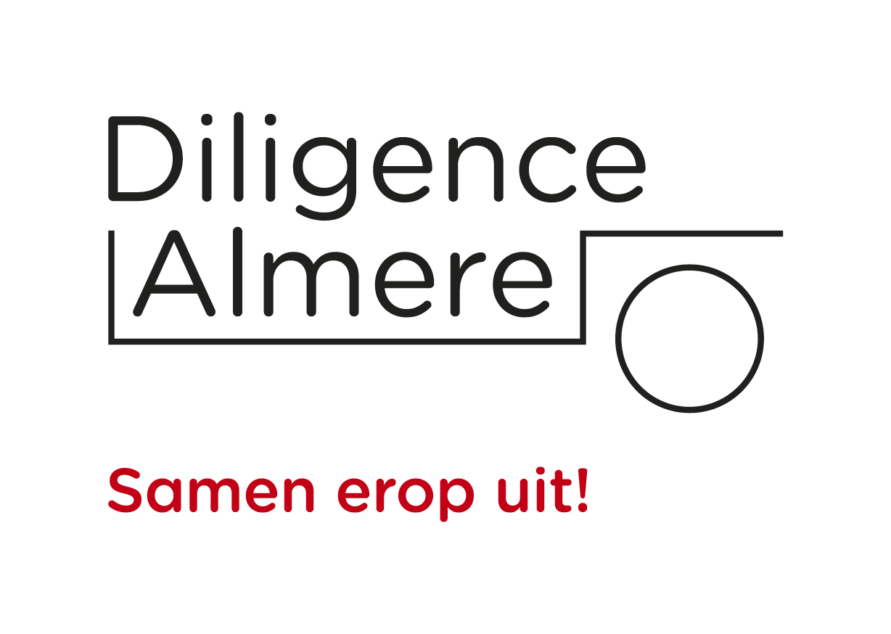

# Beheersysteem Stichting Diligence Almere

Werkende demo van het beheersysteem voor de uitjes van Stichting Diligence Almere. Vrijwilligers beheren deelnemers, het programma, de telefonische opgave, de eerlijke indeling, de reservelijst, de bellijst en het vervoer. Deelnemers hebben geen login; de applicatie is intern.



## Status

**Werkende demo (MVP), geen productieversie.** De applicatie draait, de hoofdflows zijn met een browser getest en de belangrijkste schermen zijn met axe gecontroleerd op toegankelijkheid. Echte persoonsgegevens horen hier nog niet in.

- **URL:** <http://localhost:3100> (de server draait in deze sessie)
- **Demo-accounts** (staan bewust niet op het inlogscherm; ze bestaan alleen als
  `SEED_DEMO_DATA` niet op `false` staat). Alleen voor lokaal ontwikkelen; in
  productie weigert de app te starten zonder `SEED_ADMIN_EMAIL` en een sterk
  `SEED_ADMIN_PASSWORD` en worden er nooit demo-accounts aangemaakt:
  - Beheerder: `admin@diligence.local` — wachtwoord `demo1234`
  - Coördinator: `coordinator@diligence.local` — wachtwoord `demo1234`
  - Chauffeur: `chauffeur@diligence.local` — wachtwoord `demo1234`
- Alle namen, telefoonnummers en uitjes zijn verzonnen.

## Wat werkt

- Inloggen met rollen (Admin, Coördinator, Chauffeur) en een sessiecookie.
- Dashboard met de taak van het moment en de eerstvolgende uitjes.
- Deelnemers zoeken op naam met typefouten of op telefoonnummer, deelnemer toevoegen en bekijken.
- Deelnemers importeren uit CSV, met controle vooraf en foutmeldingen per rij.
- Bezoekgeschiedenis importeren uit CSV, met koppeling aan bestaande deelnemers.
- Opschoonlijst voor deelnemers die lang niet meededen, met pauzeren of archiveren.
- Groepjes beheren: leden toevoegen en eruit halen, naam wijzigen en opheffen.
- Aanwezigheid per uitje registreren en het uitje daarmee afronden.
- Vrije plekken melden en afhandelen zonder automatische opvulling.
- Feedbackknop op elk scherm en een overzicht voor de beheerder.
- Programma importeren uit CSV of Excel (.xlsx), met maandkoppen, controle vooraf, aantal uitjes en "Ongedaan maken".
- Deelnemergegevens exporteren en een deelnemer op verzoek anonimiseren.
- Uitjes bekijken, toevoegen en de capaciteit aanpassen.
- Voertuigen toevoegen en wijzigen (naam, kenteken, aantal plekken, opmerkingen); automatisch voertuigen voorstellen op basis van capaciteit en beschikbaarheid.
- Telefonische opgave op één scherm, met groepje, bevestigingsregel en een reden als de deadline verstreken is.
- Deterministisch indelingsvoorstel met uitleg, reservelijst, handmatig "toch plaatsen" en bevestigen.
- Proefmodus: een handmatige indeling importeren en per uitje en per persoon vergelijken met het systeemvoorstel.
- Bellijst die na bevestigen ontstaat, met "Gebeld", "Niet bereikt" en "Kan niet".
- E-mailwachtrij die na bevestigen ontstaat, met demo-stand, verzenden via Brevo en een afmeldlink.
- Locaties met adres en categorie (museum, uit eten, enzovoort), te koppelen aan een uitje en te filteren in het programma.
- Aparte, printbare daglijst per uitje met deelnemers, telefoon, kaarten, mobiliteit, voertuigen en chauffeur.
- Printbaar programma per maand met logo en prijzen.
- Tweestapsverificatie met een authenticator-app, inclusief een tweede login-stap.
- Eigen rollen met rechten per onderdeel en per handeling; gebruikers beheren en aan een rol koppelen.
- Uitgebreid wijzigingsoverzicht: wie, wanneer, welke actie, oude en nieuwe waarde, filterbaar op medewerker, actie en datum.
- Het wijzigingsoverzicht is op databaseniveau onveranderlijk.
- Hulp-pagina en demo-uitleg.

## Wat nog niet in deze demo zit

Deze onderdelen staan in het ontwikkelplan, maar zijn in deze eerste werkversie bewust nog niet gebouwd:

- volledige import van de bestaande deelnemersdatabase inclusief alle velden en historie in één bestand (nu aparte CSV-imports);
- 2FA is aanwezig en kan met `ENFORCE_2FA=true` verplicht worden; in de demo staat die standaard uit;
- Auth.js;
- de modules Chauffeurskosten, Kas en AI;
- productieharding: back-up, monitoring, rate limiting en penetratietest;
- routeplanning, voertuigbeheer (kilometerstanden, onderhoud, schade) en online betalen.

Deze grenzen staan ook in [`docs/WERKVERSIE.md`](docs/WERKVERSIE.md).

## Lokaal draaien

```bash
pnpm install
pnpm dev          # ontwikkeling op http://localhost:3100
# of
pnpm build
pnpm start        # productie op http://localhost:3100
```

De applicatie gebruikt voor deze demo een ingebouwde SQLite-database (`data/diligence.db`). Bij de eerste start worden demo-gegevens geladen. De productiearchitectuur in het plan gaat uit van PostgreSQL.

**E-mail:** zonder `BREVO_API_KEY` blijft de e-mailwachtrij in demonstratiemodus; berichten worden klaargezet maar niet verstuurd. Met `BREVO_API_KEY`, `EMAIL_FROM`, `EMAIL_FROM_NAME` en `APP_URL` wordt via Brevo verzonden. Na het bevestigen van de indeling verstuurt de app de uitslag meteen naar iedereen met een e-mailadres; de wachtrij op `/berichten` blijft bestaan voor mislukte berichten. Zet in productie ook `COOKIE_SECURE=true` en `ENFORCE_2FA=true`. De sessie verloopt na 8 uur absoluut en na 60 minuten inactiviteit; `SESSION_IDLE_MINUTES` is instelbaar.

**Schoon bronarchief:** `pnpm package:source` maakt `dist/diligence-source-<datum>.tar.gz` en op Windows ook een `.zip`, zonder `.next`, `data`, cookies, database, back-ups of oude zipbestanden. De browsercontroles zoeken automatisch Chrome/Chromium; zet `CHROME_PATH` als jouw browser op een andere plek staat.

```bash
pnpm test            # unit- en SQLite-integratietests
pnpm typecheck       # TypeScript
pnpm smoke           # browser-smoketest; server moet op :3100 draaien
pnpm smoke:history   # geschiedenisimport en opschonen
pnpm smoke:proef     # proefmodus en verschillenoverzicht
pnpm smoke:2fa       # tweestapsverificatie instellen en inloggen
pnpm smoke:rollen    # eigen rol, gebruiker en logboek
pnpm smoke:groepen   # groepjes beheren
pnpm smoke:feedback  # feedback sturen en afhandelen
pnpm smoke:excel     # Excel-import met maandkoppen
pnpm smoke:avg       # export en anonimiseren
pnpm smoke:locaties  # locaties en categorieën
pnpm smoke:meldingen  # vrije plek melden
pnpm a11y            # axe-scan van de kernschermen
pnpm package:source  # schoon bronarchief zonder data, .next of cookies
```

**Demo opnieuw beginnen:** stop de server, verwijder `data/diligence.db`, `data/diligence.db-wal` en `data/diligence.db-shm`, en start opnieuw. De seed wordt dan automatisch geladen. Verwijder nooit een database zonder te controleren dat je in de demo-omgeving zit.

## Productie

De productie-opstelling staat in [`docs/PRODUCTIE.md`](docs/PRODUCTIE.md): Docker Compose met de app en Caddy, automatisch HTTPS, een persistent SQLite-volume, healthcheck, automatische herstart, versleutelde back-ups en een restoreprocedure.

Stap voor stap installeren op een eigen server bij Theory7 (op je eigen subdomein,
bijvoorbeeld `app.jouwdomein.nl`):
[`docs/INSTALLATIE-THEORY7.md`](docs/INSTALLATIE-THEORY7.md). Kort samengevat: dit
is één Node.js-proces met een SQLite-bestand, dus het past op een VPS met Docker.

Heb je een **gedeeld hostingpakket met Node.js 24** (DirectAdmin → Setup Node.js
App)? Dan kan het ook daar, zonder extra kosten:
[`docs/INSTALLATIE-DIRECTADMIN.md`](docs/INSTALLATIE-DIRECTADMIN.md).

Echte deelnemers in een lege database zetten (geen demo): zie § 12 van
`docs/INSTALLATIE-THEORY7.md`.

```bash
cp .env.example .env.production   # vul echte waarden in
docker compose --env-file .env.production up -d --build
curl -fsS https://beheer.diligence-almere.nl/api/health
```

De app heeft ingebouwde bescherming: securityheaders, login-rate-limiting, sessie-inactiviteit, verplichte 2FA voor Admin (`ENFORCE_2FA=true`), een append-only audit-log en `/api/health` voor monitoring.

**Back-up maken en testen:**

```bash
openssl rand -base64 32          # zet de uitkomst als BACKUP_KEY in .env.production
docker compose --env-file .env.production run --rm app node scripts/backup.mjs
docker compose --env-file .env.production run --rm app \
  node scripts/restore.mjs /app/backups/diligence-....db.enc /app/data/restored.db
```

De back-up- en restore-scripts zitten in de container, dus je hebt geen Node.js of
pnpm op de server nodig. Bewaar `BACKUP_KEY` buiten de server.

## Projectstructuur

```
src/app/                 pagina's, route handlers en server actions
src/domain/              zuivere indelingsmotor
src/lib/                 database, auth, zoeken, formattering, import
src/components/          UI-componenten en importformulieren
tests/                   unit tests
scripts/                 browser-smoketest en toegankelijkheidsscan
public/brand/            logo
public/templates/        voorbeeldbestanden voor import
docs/                    eisen, plan, datamodel, algoritme, import, werkversie, productie
data/                    lokale demo-database en screenshots (niet in git)
```

## Documentatie

| Document | Inhoud |
|---|---|
| [`docs/EISEN.md`](docs/EISEN.md) | Het volledige programma van eisen |
| [`docs/ONTWIKKELPLAN.md`](docs/ONTWIKKELPLAN.md) | Doel, scope, architectuur, huisstijl, planning en acceptatie |
| [`docs/DATAMODEL.md`](docs/DATAMODEL.md) | Entiteiten, constraints, versleuteling en bewaartermijnen |
| [`docs/INDELINGSALGORITME.md`](docs/INDELINGSALGORITME.md) | Regels, determinisme, uitleg en testgevallen |
| [`docs/IMPORTSPECIFICATIE.md`](docs/IMPORTSPECIFICATIE.md) | Import, validatie, preview en undo |
| [`docs/WERKVERSIE.md`](docs/WERKVERSIE.md) | Wat er in deze werkversie zit, welke afwijkingen er zijn en wat de volgende stap is |
| [`docs/PRODUCTIE.md`](docs/PRODUCTIE.md) | Hosting, TLS, back-up, restore, monitoring en de livegang-checklist |
| [`docs/INSTALLATIE-THEORY7.md`](docs/INSTALLATIE-THEORY7.md) | Installatie op een VPS bij Theory7, DNS voor je eigen subdomein, HTTPS, back-ups en probleemoplossing |
| [`docs/INSTALLATIE-DIRECTADMIN.md`](docs/INSTALLATIE-DIRECTADMIN.md) | Installatie op een gedeeld pakket via DirectAdmin → Setup Node.js App (Node.js 24) |

## Beveiliging en privacy

- Gebruik de demo niet met echte persoonsgegevens.
- Wachtwoorden worden met scrypt gehasht; sessies staan in de database en de cookie is HttpOnly.
- In productie moeten `COOKIE_SECURE=true`, `ENFORCE_2FA=true` en een sterke `RATE_LIMIT_SECRET` staan.
- Tweestapsverificatie, eigen rollen en rechten, een append-only logboek en versleutelde back-ups zijn aanwezig.
- Zie [`docs/PRODUCTIE.md`](docs/PRODUCTIE.md) voor TLS, back-up, restore, monitoring en de livegang-checklist.
