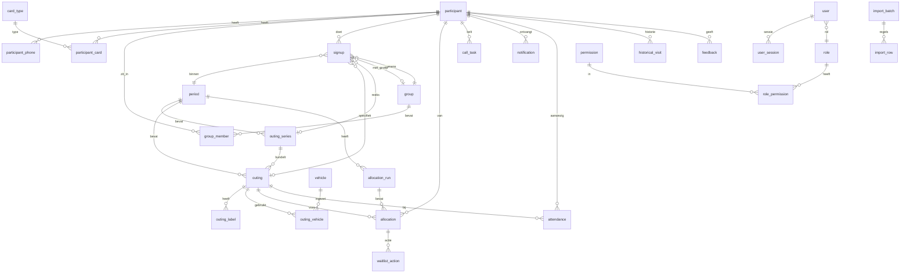

# Datamodel Beheersysteem Stichting Diligence Almere

**Versie:** 1.1  
**Datum:** 3 november 2026  
**Status:** ontwerp; hoort bij [`ONTWIKKELPLAN.md`](ONTWIKKELPLAN.md)  
**Database:** PostgreSQL 16 of hoger

Dit document beschrijft de entiteiten, velden, relaties, constraints, indexen, versleuteling en bewaartermijnen. Het is de bron voor de Drizzle-migraties in M0 en verder. De UI is Nederlands; tabel- en kolomnamen zijn Engels, volgens [`AGENTS.md`](../AGENTS.md).

---

## 1. Uitgangspunten

| Onderwerp | Afspraak |
|---|---|
| Primaire sleutels | UUID (`gen_random_uuid()`), behalve het wijzigingsoverzicht (`bigserial`) |
| Datum en tijd | `timestamptz` in UTC; datums als `date`; tijden als `time`; weergave in `Europe/Amsterdam` |
| Geld | Integer in eurocenten (`price_cents`), nooit floating point |
| Verwijderen | Nooit hard verwijderen; archiveren, pauzeren, anonimiseren of soft-delete met `archived_at` |
| Namen | Engels, `snake_case`; meervoudsvormen alleen waar natuurlijk |
| Tekst | `text` met CHECK-constraints waar nodig; geen onnodige lengtebeperkingen |
| Telefoon | Genormaliseerd opgeslagen voor de blinde index; weergave gedecrypt en geformatteerd |
| E-mail | Genormaliseerd (lowercase, getrimd) voor de blinde index; weergave gedecrypt |
| Auditing | Elke wijziging via de auditfunctie; geen directe `UPDATE`/`DELETE` op `audit_log` |
| Timezone | De motor krijgt een expliciete `reference_date`; nooit `Date.now()` in domeinlogica |

**Extensies:** `pg_trgm` (fuzzy zoeken), `unaccent` (Nederlandse namen), `pgcrypto` alleen als dat nodig blijkt; UUID-generatie zit in PostgreSQL zelf.

**SQL-afspraken:**

- `created_at timestamptz not null default now()`, `updated_at` via trigger.
- `created_by` en `updated_by` verwijzen naar `user.id`, behalve bij imports (dan `null` met `import_batch_id`).
- Elke tabel met persoonsgegevens heeft een `archived_at` of een status, nooit een `DELETE`.
- `ON DELETE RESTRICT` als standaard; cascade alleen bij zuiver technische childtabellen (sessies, rolrechten).
- Migraties zijn vooruit- en terugdraaibaar; een migratie die gegevens raakt wordt eerst op test gedraaid.

---

## 2. Overzicht



---

## 3. Enums

| Enum | Waarden | Nederlandse UI |
|---|---|---|
| `participant_status` | `active`, `paused`, `stopped` | actief, tijdelijk gepauzeerd, gestopt |
| `contact_preference` | `phone`, `email`, `both` | telefoon, e-mail, allebei |
| `period_status` | `draft`, `published`, `closed`, `archived` | concept, gepubliceerd, gesloten, gearchiveerd |
| `outing_status` | `planned`, `cancelled`, `completed` | gepland, geannuleerd, afgerond |
| `outing_label` | `new`, `repeat`, `popular`, `one_time`, `featured` | Nieuw, Op herhaling, Op veler verzoek, Eenmalig, Uitgelicht |
| `signup_target` | `outing`, `series`, `period` | dit uitje, deze reeks, alle uitjes |
| `signup_group_mode` | `with_group`, `alone` | met groepje, alleen |
| `signup_status` | `active`, `cancelled` | actief, geannuleerd |
| `allocation_run_kind` | `system`, `manual` | systeemvoorstel, handmatige indeling |
| `allocation_run_phase` | `proposal`, `confirmed` | voorstel, bevestigd |
| `allocation_status` | `assigned`, `waitlist`, `rejected`, `tie_pending` | ingedeeld, reservelijst, afgewezen, gelijke stand |
| `allocation_source` | `system`, `manual`, `pinned` | systeem, handmatig, vastgezet |
| `waitlist_action_type` | `offered`, `accepted`, `declined`, `unreachable` | aangeboden, komt mee, kan niet, niet bereikt |
| `call_task_kind` | `placed`, `reserve`, `not_placed`, `cancelled` | ingedeeld, reservelijst, niet ingedeeld, uitje geannuleerd |
| `call_task_status` | `to_call`, `called`, `not_reached`, `done` | nog bellen, gebeld, niet bereikt, afgehandeld |
| `notification_status` | `queued`, `sent`, `failed`, `bounced` | in wachtrij, verzonden, mislukt, geweigerd |
| `user_status` | `active`, `disabled` | actief, uitgeschakeld |
| `import_batch_type` | `program`, `participants`, `history`, `signups`, `manual_allocation` | programma, deelnemers, geschiedenis, opgaven, handmatige indeling |
| `import_batch_status` | `preview`, `committed`, `undone`, `failed` | controle, opgeslagen, ongedaan gemaakt, mislukt |
| `import_row_status` | `valid`, `warning`, `needs_review`, `error` | goed, let op, beoordelen, fout |
| `feedback_status` | `new`, `in_progress`, `done` | nieuw, in behandeling, afgehandeld |
| `module_key` | `expenses`, `cash`, `assistant` | Chauffeurskosten, Kas, AI-assistent |

Enums worden als PostgreSQL-enum of als `text` met CHECK uitgevoerd. Bij twijfel: `text` met CHECK, omdat een enum lastiger uit te breiden is. De uiteindelijke keuze wordt in M0 vastgelegd.

---

## 4. Deelnemers

### 4.1 `participant`

| Kolom | Type | Constraints | Toelichting |
|---|---|---|---|
| `id` | uuid | pk, default `gen_random_uuid()` | |
| `first_name` | text | not null | Roepnaam/voornaam |
| `last_name_prefix` | text | | Tussenvoegsel, bijvoorbeeld "de" |
| `last_name` | text | not null | Achternaam |
| `search_name` | text | not null | Genormaliseerd: lowercase, zonder accenten, extra spaties weg |
| `street` | text | | Straatnaam |
| `house_number` | text | | Huisnummer, als tekst omdat "12a" voorkomt |
| `house_number_addition` | text | | Toevoeging |
| `postal_code` | text | | Nederlandse postcode, genormaliseerd naar `1234 AB` |
| `city` | text | | Standaard leeg; geen aanname dat iedereen in Almere woont |
| `email_ciphertext` | bytea | | Versleuteld e-mailadres |
| `email_blind_index` | text | index | HMAC van genormaliseerd e-mailadres, voor duplicaatcontrole |
| `contact_preference` | contact_preference | not null, default `phone` | 1.11 |
| `status` | participant_status | not null, default `active` | 1.4 |
| `stopped_on` | date | | Verplicht bij status `stopped` |
| `stop_reason` | text | | Verplicht bij status `stopped`; bijvoorbeeld verhuisd, overleden, zelf gestopt |
| `mobility_walker` | boolean | not null, default false | Rollator (1.5) |
| `mobility_wheelchair` | boolean | not null, default false | Rolstoel (1.5) |
| `mobility_help_boarding` | boolean | not null, default false | Hulp bij instappen (1.5) |
| `notes_ciphertext` | bytea | | Versleutelde vrije notities |
| `emergency_contact_name_ciphertext` | bytea | | Noodcontact (1.6) |
| `emergency_contact_phone_ciphertext` | bytea | | Noodcontact (1.6) |
| `emergency_contact_relation_ciphertext` | bytea | | Noodcontact (1.6) |
| `email_unsubscribed_at` | timestamptz | | Afmelding voor e-mail (5.14) |
| `email_bounced_at` | timestamptz | | Laatste harde bounce |
| `guarantee_remaining` | smallint | CHECK 0–2, null toegestaan | Restant van de garantie van twee uitjes; null = niet van toepassing |
| `guarantee_started_period_id` | uuid | fk `period` | Periode waarin de garantie begon |
| `dek_wrapped` | bytea | | Ingepakte persoonssleutel (envelope-encryptie) |
| `dek_key_id` | text | | Id van de hoofdsleutel |
| `anonymized_at` | timestamptz | | Geanonimiseerd op verzoek |
| `archived_at` | timestamptz | | Gearchiveerd, niet verwijderd |
| `created_at` | timestamptz | not null | |
| `updated_at` | timestamptz | not null | |
| `created_by` | uuid | fk `user` | |
| `updated_by` | uuid | fk `user` | |

**Checks:**

```sql
CHECK (status <> 'stopped' OR (stopped_on IS NOT NULL AND stop_reason IS NOT NULL))
CHECK (guarantee_remaining IS NULL OR guarantee_remaining BETWEEN 0 AND 2)
CHECK (anonymized_at IS NULL OR (first_name = 'Deelnemer' AND last_name = 'Geanonimiseerd'))
```

**Indexen:**

- GIN op `search_name` met `gin_trgm_ops` voor fuzzy zoeken.
- B-tree op `(status, archived_at)`.
- B-tree op `guarantee_started_period_id`.
- Unieke index op `email_blind_index` waar `email_blind_index IS NOT NULL AND archived_at IS NULL`? **Niet** uniek: twee deelnemers kunnen hetzelfde e-mailadres delen (echtpaar). Wel een gewone index en een duplicaatwaarschuwing in de UI.
- `lower(search_name)` is al genormaliseerd.

**Waarom namen niet versleuteld:** zoeken op een half naamdeel met typefouten vereist trigrammen op platte tekst. Telefoon, e-mail, notities en noodcontact zijn wel versleuteld. Deze afweging staat in de DPIA; toegang is beperkt en de database is versleuteld op schijf.

### 4.2 `participant_phone`

| Kolom | Type | Constraints |
|---|---|---|
| `id` | uuid | pk |
| `participant_id` | uuid | fk `participant`, not null |
| `label` | text | bijvoorbeeld "vast", "mobiel", "werk" |
| `number_ciphertext` | bytea | not null |
| `number_blind_index` | text | not null, index |
| `is_primary` | boolean | not null, default false |
| `created_at` | timestamptz | not null |
| `archived_at` | timestamptz | |

- Partiële unieke index: één `is_primary = true` per deelnemer waar `archived_at IS NULL`.
- Normalisatie: verwijder spaties, streepjes en haakjes; `+31` naar `0`; alleen cijfers in de blinde index. Bij een buitenlands nummer blijft de landcode staan.
- De weergave wordt uit de ciphertext gedecrypt en geformatteerd.

### 4.3 `card_type` en `participant_card`

`card_type`: `id` uuid, `name` text uniek, `active` boolean, `sort_order` smallint. Seed: Museumkaart, VriendenLoterij. De Beheerder kan types toevoegen (bijvoorbeeld BankGiro Loterij VIP) en deactiveren.

`participant_card`: `participant_id` + `card_type_id` als samengestelde pk, `created_at`, `archived_at`. Geen bedragen; alleen welke kaart iemand heeft (1.10).

---

## 5. Groepjes

### 5.1 `group`

| Kolom | Type | Constraints |
|---|---|---|
| `id` | uuid | pk |
| `name` | text | not null, bijvoorbeeld "De wandelvrienden" |
| `active` | boolean | not null, default true |
| `created_at` / `updated_at` | timestamptz | not null |
| `created_by` / `updated_by` | uuid | fk `user` |
| `disbanded_at` | timestamptz | |

Het groepje wordt nooit hard verwijderd. Ontbinden zet `disbanded_at` en sluit de lidmaatschappen; "Ongedaan maken" opent ze weer.

### 5.2 `group_member`

| Kolom | Type | Constraints |
|---|---|---|
| `id` | uuid | pk |
| `group_id` | uuid | fk `group`, not null |
| `participant_id` | uuid | fk `participant`, not null |
| `valid_from` | timestamptz | not null |
| `valid_until` | timestamptz | null = actief |
| `created_at` | timestamptz | not null |

- Partiële unieke index op `participant_id` waar `valid_until IS NULL`: maximaal één actief groepje per persoon (2.3).
- Check `valid_until IS NULL OR valid_until > valid_from`.
- Geschiedenis blijft bewaard; een deelnemer kan na ontbinden in een nieuw groepje.

---

## 6. Periodes, uitjes en voertuigen

### 6.1 `period`

| Kolom | Type | Constraints |
|---|---|---|
| `id` | uuid | pk |
| `name` | text | not null, bijvoorbeeld "November–december 2026" |
| `start_date` | date | not null |
| `end_date` | date | not null |
| `signup_deadline` | date | not null |
| `status` | period_status | not null, default `draft` |
| `default_capacity` | smallint | not null, default 14, CHECK 1–100 |
| `published_at` | timestamptz | |
| `closed_at` | timestamptz | |
| `created_at` / `updated_at` | timestamptz | not null |
| `created_by` / `updated_by` | uuid | fk `user` |

Checks: `end_date >= start_date`; `signup_deadline BETWEEN start_date AND end_date`. Publiceren en sluiten worden in het wijzigingsoverzicht vastgelegd.

### 6.2 `outing_series`

Een reeks bundelt hetzelfde uitje op meerdere data (3.10), bijvoorbeeld "Pannenkoekhuis De Smickel" op 23 en 25 november.

| Kolom | Type | Constraints |
|---|---|---|
| `id` | uuid | pk |
| `period_id` | uuid | fk `period`, not null |
| `name` | text | not null |
| `description` | text | |
| `default_capacity` | smallint | CHECK 1–100, null = periode-standaard |
| `created_at` / `updated_at` | timestamptz | not null |
| `created_by` / `updated_by` | uuid | fk `user` |

### 6.3 `outing`

| Kolom | Type | Constraints |
|---|---|---|
| `id` | uuid | pk |
| `period_id` | uuid | fk `period`, not null |
| `series_id` | uuid | fk `outing_series`, null |
| `outing_date` | date | not null |
| `start_time` | time | not null |
| `end_time` | time | not null |
| `description` | text | not null |
| `price_cents` | integer | not null, default 0, CHECK >= 0 |
| `extra_costs_text` | text | bijvoorbeeld "Lunch / Consumptie" |
| `capacity` | smallint | not null, CHECK 1–100 |
| `less_suitable_walkers` | boolean | not null, default false |
| `status` | outing_status | not null, default `planned` |
| `notes_internal` | text | alleen voor medewerkers; geen deelnemersnotities |
| `created_at` / `updated_at` | timestamptz | not null |
| `created_by` / `updated_by` | uuid | fk `user` |

Checks: `end_time > start_time`; `outing_date` tussen periode-start en -eind; `capacity > 0`. Een uitje dat wordt geannuleerd, houdt zijn gegevens; de bellijst wordt gegenereerd.

`outing_label`: `outing_id` + `label` als pk. Een uitje kan meerdere labels hebben.

### 6.4 `vehicle` — flexibel beheer

| Kolom | Type | Constraints | Toelichting |
|---|---|---|---|
| `id` | uuid | pk | |
| `name` | text | not null | bijvoorbeeld "Busje 1" of "Touringcar" |
| `license_plate` | text | | Kenteken zoals ingevoerd, bijvoorbeeld "12-ABC-3" |
| `license_plate_normalized` | text | | Hoofdletters, zonder spaties/streepjes; voor vergelijking |
| `seat_capacity` | smallint | not null, CHECK 1–100 | Aantal gasten dat meekan; chauffeur en begeleider tellen niet mee (te bevestigen, open punt 8) |
| `active` | boolean | not null, default true | |
| `notes` | text | | Bijzonderheden, bijvoorbeeld "mindervalidenlift" |
| `archived_at` | timestamptz | | Nooit hard verwijderen |
| `created_at` / `updated_at` | timestamptz | not null | |
| `created_by` / `updated_by` | uuid | fk `user` | |

- **Uniek kenteken:** partiële unieke index op `license_plate_normalized` waar `archived_at IS NULL`. Twee actieve voertuigen met hetzelfde kenteken is een fout; een gearchiveerd voertuig blokkeert een nieuw voertuig met dat kenteken niet.
- **Wijzigen:** naam, kenteken, aantal plekken, opmerkingen en actief zijn altijd aanpasbaar. Elke wijziging wordt geaudit.
- **Capaciteit is een snapshot bij toewijzing:** bestaande `outing_vehicle`-rijen houden het aantal plekken en het kenteken van het moment van toewijzing. Zo verandert een daglijst uit het verleden niet met terugwerkende kracht.
- **Geen kilometerstanden, onderhoud of schade** in deze tabel; die horen bij 6.8 en zijn buiten scope.

### 6.5 `outing_vehicle`

| Kolom | Type | Constraints |
|---|---|---|
| `id` | uuid | pk |
| `outing_id` | uuid | fk `outing`, not null |
| `vehicle_id` | uuid | fk `vehicle`, not null |
| `service_date` | date | not null; gelijk aan `outing.outing_date` |
| `driver_user_id` | uuid | fk `user`, null |
| `seats_snapshot` | smallint | not null |
| `license_plate_snapshot` | text | |
| `assigned_at` | timestamptz | not null |
| `assigned_by` | uuid | fk `user` |
| `notes` | text | |

- Unieke index `(outing_id, vehicle_id)`.
- Unieke index `(vehicle_id, service_date)` voorkomt dubbele boeking op dezelfde dag (6.4).
- Trigger controleert dat `service_date` gelijk is aan de datum van het uitje; bij wijzigen van de uitjesdatum wordt de koppeling opnieuw beoordeeld.
- Bij toevoegen worden `seats_snapshot` en `license_plate_snapshot` gevuld vanuit `vehicle`.
- De chauffeur is een gebruiker met de rol Chauffeur (of een eigen rol met het recht "eigen uitjes zien"). Een uitje zonder chauffeur geeft een waarschuwing, geen blokkade (6.5).

**Automatische toewijzing** gebeurt in de applicatie, niet in de database: actieve, die dag vrije voertuigen, combinatie met zo weinig mogelijk lege plekken, dan zo weinig mogelijk voertuigen, dan vaste sortering. De database bewaakt alleen de dubbele boeking en de geldigheid.

---

## 7. Opgaven

### 7.1 `signup`

| Kolom | Type | Constraints | Toelichting |
|---|---|---|---|
| `id` | uuid | pk | |
| `period_id` | uuid | fk `period`, not null | |
| `participant_id` | uuid | fk `participant`, not null | |
| `target_type` | signup_target | not null | `outing`, `series`, `period` |
| `outing_id` | uuid | fk `outing`, null | Verplicht bij `outing` |
| `series_id` | uuid | fk `outing_series`, null | Verplicht bij `series` |
| `group_id` | uuid | fk `group`, null | Alleen bij `with_group` |
| `group_mode` | signup_group_mode | not null, default `with_group` | 4.4 en Besluit 11 |
| `note` | text | | 4.8; later scherm |
| `status` | signup_status | not null, default `active` | |
| `created_at` | timestamptz | not null | |
| `created_by` | uuid | fk `user`, not null | |
| `cancelled_at` | timestamptz | | |
| `cancelled_reason` | text | | Verplicht bij annuleren |

**Checks:**

```sql
CHECK (
  (target_type = 'outing' AND outing_id IS NOT NULL AND series_id IS NULL) OR
  (target_type = 'series' AND series_id IS NOT NULL AND outing_id IS NULL) OR
  (target_type = 'period' AND outing_id IS NULL AND series_id IS NULL)
)
CHECK (group_mode = 'alone' OR group_id IS NOT NULL)
CHECK (status <> 'cancelled' OR (cancelled_at IS NOT NULL AND cancelled_reason IS NOT NULL))
```

- Unieke partiële index op `(participant_id, target_type, outing_id, series_id)` waar `status = 'active'`; PostgreSQL 15+ kan `NULLS NOT DISTINCT` gebruiken, anders komen er drie partiële indexen.
- De applicatie voorkomt dat iemand zowel een specifieke als een reeksopgave voor hetzelfde uitje heeft; de specifieke wint en de reeksopgave wordt bij het opslaan samengevoegd of geweigerd met uitleg.
- `period_id` moet overeenkomen met de periode van het gekozen uitje of de reeks; een trigger of applicatiecheck bewaakt dat.
- Een opgave wordt nooit hard verwijderd; annuleren houdt de historie.

### 7.2 `attendance`

| Kolom | Type | Constraints |
|---|---|---|
| `id` | uuid | pk |
| `participant_id` | uuid | fk `participant`, not null |
| `outing_id` | uuid | fk `outing`, not null |
| `present` | boolean | not null, default true |
| `source` | text | `manual`, `import`, `driver` |
| `recorded_at` | timestamptz | not null |
| `recorded_by` | uuid | fk `user` |

- Unieke index `(participant_id, outing_id)`.
- Alleen voor afgeronde uitjes; de applicatie controleert de status.
- Aanwezigheid voedt de bezoekgeschiedenis (1.3) en de 12-maandstelling.

### 7.3 `historical_visit`

| Kolom | Type | Constraints |
|---|---|---|
| `id` | uuid | pk |
| `participant_id` | uuid | fk `participant`, not null |
| `visit_date` | date | not null |
| `description` | text | bijvoorbeeld de naam van het uitje |
| `source_import_id` | uuid | fk `import_batch` |
| `created_at` | timestamptz | not null |

- Index `(participant_id, visit_date DESC)`.
- Historische bezoeken zijn geen uitjes in de periode; ze tellen mee voor "vaak geweest", "nieuw" en "laatst meegeweest".
- Oudere bezoeken blijven staan; alleen de telling gebruikt de terugkijkperiode.

---

## 8. Indeling en proefmodus

### 8.1 `allocation_run`

| Kolom | Type | Constraints |
|---|---|---|
| `id` | uuid | pk |
| `period_id` | uuid | fk `period`, not null |
| `kind` | allocation_run_kind | not null |
| `phase` | allocation_run_phase | not null |
| `version` | integer | not null, CHECK >= 1 |
| `parent_run_id` | uuid | fk `allocation_run`, null |
| `algorithm_version` | text | not null, bijvoorbeeld `1.0.0` |
| `input_hash` | text | not null, SHA-256 van de canonieke invoer |
| `reference_date` | date | not null; peildatum voor de 12-maandstelling |
| `created_at` | timestamptz | not null |
| `created_by` | uuid | fk `user` |
| `confirmed_at` | timestamptz | |
| `confirmed_by` | uuid | fk `user` |
| `notes` | text | |

- Unieke index `(period_id, kind, phase, version)`.
- Een **systeemvoorstel** is `kind = system`, `phase = proposal`.
- Een **handmatige werkelijkheid** voor de proefmodus is `kind = manual`, `phase = proposal`.
- Een **bevestigde indeling** is een run met `phase = confirmed`; de laatste bevestigde run per periode geldt.
- Een herberekening maakt een nieuwe versie met `parent_run_id`; oude versies blijven staan.
- Proefmodus bevestigt niets en verstuurt niets; alleen `phase = confirmed` activeert de bellijst en e-mails.

### 8.2 `allocation`

| Kolom | Type | Constraints |
|---|---|---|
| `id` | uuid | pk |
| `run_id` | uuid | fk `allocation_run`, not null |
| `outing_id` | uuid | fk `outing`, null |
| `participant_id` | uuid | fk `participant`, null |
| `group_id` | uuid | fk `group`, null |
| `status` | allocation_status | not null |
| `rank` | integer | waitlist-volgorde, CHECK >= 0 |
| `source` | allocation_source | not null |
| `reason_code` | text | not null |
| `reason_params` | jsonb | not null, default `{}` |
| `decided_by_user_id` | uuid | fk `user`, null |
| `created_at` | timestamptz | not null |

- Unieke index `(run_id, outing_id, participant_id)` waar `participant_id IS NOT NULL`.
- Voor een groepje krijgt elk lid een rij met dezelfde `group_id`, status en rang; zo blijven daglijsten eenvoudig.
- `reason_params` bevat alleen ids, aantallen en datums, geen namen of andere persoonsgegevens. De Nederlandse uitleg wordt bij het lezen samengesteld (zie `INDELINGSALGORITME.md`).
- `status = tie_pending` betekent: plek vrijgehouden tot de coördinator beslist; geen automatische keuze.
- `source = pinned` betekent: handmatig vastgezet en blijft bij herberekenen staan.

### 8.3 `waitlist_action`

| Kolom | Type | Constraints |
|---|---|---|
| `id` | uuid | pk |
| `allocation_id` | uuid | fk `allocation`, not null |
| `action` | waitlist_action_type | not null |
| `actor_user_id` | uuid | fk `user`, not null |
| `acted_at` | timestamptz | not null |
| `note` | text | |

De actiehistorie is de bron voor "kan niet" en "niet bereikt"; de reservelijstvolgorde wordt hierdoor aangepast. Een "kan niet" heeft geen negatief effect op de eerlijkheidsscore (Besluit 12).

### 8.4 `call_task`

| Kolom | Type | Constraints |
|---|---|---|
| `id` | uuid | pk |
| `participant_id` | uuid | fk `participant`, not null |
| `outing_id` | uuid | fk `outing`, null |
| `period_id` | uuid | fk `period`, not null |
| `kind` | call_task_kind | not null |
| `channel` | text | `phone` of `email` |
| `message_key` | text | template-sleutel; tekst wordt gerenderd |
| `status` | call_task_status | not null, default `to_call` |
| `attempts` | smallint | not null, default 0 |
| `last_attempt_at` | timestamptz | |
| `assigned_to` | uuid | fk `user`, null |
| `note` | text | |
| `created_at` / `updated_at` | timestamptz | not null |

- Index `(status, created_at)` en `(assigned_to, status)`.
- De bellijst toont naam, telefoon, boodschap en status; één klik op "gebeld" (5.13).
- Geen gevoelige gegevens in `message_key`; de tekst wordt uit een template en veilige velden samengesteld.

---

## 9. Berichten

### 9.1 `notification`

| Kolom | Type | Constraints |
|---|---|---|
| `id` | uuid | pk |
| `participant_id` | uuid | fk `participant`, not null |
| `kind` | text | `result`, `confirmation`, `reminder`, `cancellation` |
| `recipient_ciphertext` | bytea | versleuteld e-mailadres |
| `recipient_blind_index` | text | HMAC voor dedupe/diagnostics |
| `template_key` | text | not null |
| `payload` | jsonb | alleen niet-gevoelige velden (uitje, datum, status) |
| `status` | notification_status | not null, default `queued` |
| `provider_message_id` | text | |
| `sent_at` | timestamptz | |
| `error_code` | text | |
| `unsubscribe_token_hash` | text | hash van het token, niet het token zelf |
| `created_at` | timestamptz | not null |

- Geen mobiliteit, notities of andere gevoelige gegevens in `payload` (5.14).
- Elke verzending is terug te zien in het wijzigingsoverzicht.
- Bij een harde bounce wordt `participant.email_bounced_at` gezet en gaat de deelnemer naar de bellijst.

---

## 10. Gebruikers, rollen en rechten

### 10.1 `user`

| Kolom | Type | Constraints |
|---|---|---|
| `id` | uuid | pk |
| `name` | text | not null |
| `email` | text | not null |
| `email_normalized` | text | not null, uniek |
| `password_hash` | text | not null, Argon2id |
| `role_id` | uuid | fk `role`, not null |
| `status` | user_status | not null, default `active` |
| `two_factor_secret_ciphertext` | bytea | |
| `two_factor_enabled` | boolean | not null, default false |
| `recovery_codes_hashed` | jsonb | gehashte eenmalige codes |
| `last_login_at` | timestamptz | |
| `failed_login_attempts` | smallint | not null, default 0 |
| `locked_until` | timestamptz | |
| `created_at` / `updated_at` | timestamptz | not null |
| `disabled_at` | timestamptz | |

- Accounts worden uitgeschakeld, niet verwijderd (9.6).
- Eén rol per gebruiker; een eigen rol is een `role` met eigen rechten. Meerdere rollen per gebruiker is niet nodig en maakt de rechtenmatrix onduidelijker.
- 2FA is verplicht voor Admin en Beheerder; de applicatie dwingt de enrollment af bij de eerste login.

### 10.2 `role`, `permission`, `role_permission`

- `role`: `id`, `key`, `name`, `is_system`, `description`, `created_at`. Systeemrollen: Admin, Beheerder, Coördinator, Chauffeur, Penningmeester.
- `permission`: `id`, `key` (bijvoorbeeld `participant.view`, `allocation.confirm`, `module.toggle`), `description`.
- `role_permission`: `role_id` + `permission_id` als pk, `created_at`.
- Rechten worden nooit op rolnaam gecontroleerd, altijd op `permission.key`.
- Een gebruiker kan geen recht toekennen dat hij zelf niet heeft; de server controleert dat bij het opslaan van een rol.

### 10.3 `user_session`

| Kolom | Type | Constraints |
|---|---|---|
| `id` | uuid | pk |
| `user_id` | uuid | fk `user`, not null |
| `token_hash` | text | not null, uniek |
| `mfa_verified` | boolean | not null, default false |
| `created_at` | timestamptz | not null |
| `last_seen_at` | timestamptz | not null |
| `expires_at` | timestamptz | not null |
| `idle_expires_at` | timestamptz | not null |
| `revoked_at` | timestamptz | |
| `ip_hash` | text | |
| `user_agent` | text | ingekort |

Auth.js beheert de sessies; deze tabel is de databaseopslag. Na de eerste login is `mfa_verified = false` en blokkeert de applicatie alles behalve de tweestapspagina.

---

## 11. Modules en instellingen

### 11.1 `module`

| Kolom | Type | Constraints |
|---|---|---|
| `key` | module_key | pk |
| `enabled` | boolean | not null, default false |
| `description` | text | |
| `updated_at` | timestamptz | not null |
| `updated_by` | uuid | fk `user` |

- Seed: `expenses` (uit), `cash` (uit, vereist `expenses`), `assistant` (uit).
- De kern staat altijd aan en heeft geen rij nodig.
- Alleen de Admin mag `enabled` wijzigen; de wijziging komt in het wijzigingsoverzicht.
- `cash` kan niet aan als `expenses` uit staat (14.6).

### 11.2 `setting`

| Kolom | Type | Constraints |
|---|---|---|
| `key` | text | pk |
| `value` | jsonb | not null |
| `description` | text | |
| `updated_at` | timestamptz | not null |
| `updated_by` | uuid | fk `user` |

Voorbeelden: `default_capacity`, `lookback_months` (12), `cleanup_months` (24), `guarantee_count` (2), `idle_minutes` (60), `cash_threshold` (later), `assistant_enabled` (uit). Instellingen worden gevalideerd en geaudit.

---

## 12. Import en undo

### 12.1 `import_batch`

| Kolom | Type | Constraints |
|---|---|---|
| `id` | uuid | pk |
| `type` | import_batch_type | not null |
| `status` | import_batch_status | not null, default `preview` |
| `file_name` | text | |
| `file_hash` | text | SHA-256 van het bronbestand |
| `period_id` | uuid | fk `period`, null |
| `summary` | jsonb | aantallen, fouten, waarschuwingen |
| `error_count` | integer | not null, default 0 |
| `created_at` | timestamptz | not null |
| `created_by` | uuid | fk `user`, not null |
| `committed_at` | timestamptz | |
| `undone_at` | timestamptz | |

### 12.2 `import_row`

| Kolom | Type | Constraints |
|---|---|---|
| `id` | uuid | pk |
| `batch_id` | uuid | fk `import_batch`, not null |
| `row_number` | integer | not null |
| `raw` | jsonb | ruwe celwaarden |
| `normalized` | jsonb | genormaliseerde waarden |
| `status` | import_row_status | not null |
| `errors` | jsonb | lijst met foutcodes en parameters |
| `created_entity_type` | text | |
| `created_entity_id` | uuid | |

- Geen persoonsgegevens in `errors`; alleen veldnamen, rijnummers en foutcodes.
- `raw` en `normalized` kunnen persoonsgegevens bevatten; ze worden na de importtermijn opgeruimd en nooit naar logs geschreven.
- Undo gebruikt de created-entity-verwijzingen. Zijn er afhankelijkheden (opgaven, aanwezigheid, indeling), dan blokkeert de undo en legt uit wat er in de weg staat.

---

## 13. Wijzigingsoverzicht en inzagelog

### 13.1 `audit_log`

| Kolom | Type | Constraints |
|---|---|---|
| `id` | bigserial | pk |
| `occurred_at` | timestamptz | not null, default now() |
| `actor_user_id` | uuid | fk `user`, null |
| `actor_name` | text | snapshot van de naam op dat moment |
| `action` | text | bijvoorbeeld `participant.update`, `allocation.confirm` |
| `entity_type` | text | |
| `entity_id` | uuid | |
| `before` | jsonb | oude waarden, gevoelige velden versleuteld |
| `after` | jsonb | nieuwe waarden, gevoelige velden versleuteld |
| `summary_template` | text | bijvoorbeeld `participant.signup_cancelled` |
| `summary_params` | jsonb | ids, datums, aantallen; geen namen |
| `ip_hash` | text | |
| `request_id` | text | |
| `prev_hash` | text | hash van het vorige event |
| `hash` | text | SHA-256 van dit event inclusief `prev_hash` |

**Onveranderlijkheid:**

- Trigger `audit_log_immutable` weigert `UPDATE` en `DELETE`.
- De applicatierol krijgt alleen `INSERT` en `SELECT`; onderhoudsrollen hebben geen `UPDATE`/`DELETE`.
- De hash-keten wordt dagelijks verankerd in een bestand in de objectopslag. Een onderbreking is zichtbaar bij controle.
- Geen enkele rol, ook Admin niet, kan een event wijzigen of verwijderen.

**Leesbare samenvatting:** de UI rendert `summary_template` + `summary_params` met de actuele namen. Zo staat er "Els heeft Jan de Vries afgemeld voor Efteling op 3 maart" zonder dat de naam als tekst in het auditrecord hoeft te staan. Bij anonimisering wordt de naam in de weergave "Geanonimiseerd"; de versleutelde oude waarden zijn dan niet meer leesbaar.

**Gevoelige waarden:** `before` en `after` bevatten voor telefoon, e-mail, notities en noodcontact een versleutelde waarde met de persoonssleutel. Na anonimisering (sleutelvernietiging) zijn die waarden onleesbaar; de niet-gevoelige velden blijven leesbaar.

### 13.2 `access_log`

| Kolom | Type | Constraints |
|---|---|---|
| `id` | bigserial | pk |
| `user_id` | uuid | fk `user`, not null |
| `participant_id` | uuid | fk `participant`, null |
| `action` | text | `view`, `export`, `print` |
| `context` | text | scherm of rapport |
| `occurred_at` | timestamptz | not null |

Inzage in persoonsgegevens wordt vastgelegd (10.4). De log bevat geen inhoud, alleen wie wat bekeek.

---

## 14. Feedback

### 14.1 `feedback`

| Kolom | Type | Constraints |
|---|---|---|
| `id` | uuid | pk |
| `user_id` | uuid | fk `user`, null |
| `route` | text | scherm waar de gebruiker zat |
| `message` | text | not null |
| `status` | feedback_status | not null, default `new` |
| `created_at` | timestamptz | not null |
| `handled_by` | uuid | fk `user`, null |
| `handled_at` | timestamptz | |
| `note_internal` | text | |

Geen persoonsgegevens in `route`; het bericht is vrije tekst en wordt niet automatisch in logs opgenomen.

---

## 15. Zoeken

### 15.1 Naam

- `participant.search_name` wordt bij elke wijziging gevuld: lowercase, `unaccent`, dubbele spaties weg, leestekens weg.
- Index: `CREATE INDEX ... USING gin (search_name gin_trgm_ops);`
- Query: eerst prefix/`ILIKE`, daarna `similarity(search_name, :q) > 0.3`, gesorteerd op similarity en naam.
- Minimale zoeklengte: 2 tekens. Resultaten worden beperkt tot wat de rol mag zien.
- Geen zoekindex op versleutelde velden.

### 15.2 Telefoon

- Normaliseer naar cijfers, `+31` naar `0`, geen spaties.
- `number_blind_index = HMAC-SHA256(search_key, normalized_number)`.
- Exacte match op de blinde index; meerdere nummers per deelnemer.
- Een zoekopdracht met spaties of streepjes wordt hetzelfde genormaliseerd.

### 15.3 E-mail

- `email_blind_index` voor duplicaatcontrole en diagnostiek; geen vrije zoekfunctie.
- Weergave alleen na ontsleuteling en alleen voor rollen met het recht.

---

## 16. Versleuteling

### 16.1 Sleutels

| Sleutel | Bewaarplaats | Gebruik |
|---|---|---|
| Hoofdsleutel (`APP_DATA_KEY`) | omgevingsvariabele/secret manager, niet in de database | Inpakken van persoonssleutels |
| Zoeksleutel (`APP_SEARCH_KEY`) | omgevingsvariabele/secret manager | HMAC voor telefoon en e-mail |
| Persoonssleutel (DEK) | `participant.dek_wrapped` | Versleutelen van gevoelige velden van één deelnemer |

- AES-256-GCM met een willekeurige nonce per veld.
- AAD: `participant:{id}:{field}` voorkomt dat ciphertext tussen velden of personen wordt verwisseld.
- Formaat: `v1:{key_id}:{nonce_base64}:{ciphertext_base64}:{tag_base64}`.
- De hoofdsleutel wordt nooit in de database, logs of back-up van de database bewaard.
- Rotatie: nieuwe DEK inpakken met de nieuwe hoofdsleutel; velden kunnen lui opnieuw worden versleuteld.

### 16.2 Welke velden

| Velden | Versleuteld | Toelichting |
|---|---|---|
| Telefoonnummers | ja | Blind index voor zoeken |
| E-mailadres | ja | Blind index voor duplicaten |
| Notities | ja | Vrije tekst |
| Noodcontact | ja | Naam, telefoon, relatie |
| Naam | nee | Nodig voor fuzzy zoeken; DPIA-afweging |
| Adres | nee | Nodig voor latere routeplanning; DPIA-afweging |
| Mobiliteit | nee (booleans) | Wel streng beperken; mogelijk gezondheidsgegeven |
| Geboortedatum | niet opgeslagen | Niet nodig voor de eisen |

### 16.3 Anonimiseren

1. Zet `anonymized_at`.
2. Vervang naam door "Deelnemer" / "Geanonimiseerd"; wis adres, e-mail, telefoon, notities en noodcontact.
3. Vernietig `dek_wrapped`; daarmee worden ook de versleutelde oude waarden in het wijzigingsoverzicht onleesbaar.
4. Bewaar deelnamestatistieken zonder identiteit (aantallen en datums).
5. Schrijf een audit-event met `summary_template = participant.anonymized`.
6. Back-ups verlopen volgens de bewaartermijn; documenteer dat de anonimisering daar pas na verloop van tijd volledig is.

---

## 17. Bezoekgeschiedenis en de 12-maandstelling

### 17.1 Bronnen

- `attendance` voor deelnames aan uitjes in het systeem.
- `historical_visit` voor de import van de bestaande geschiedenis.

### 17.2 Definities

| Begrip | Berekening |
|---|---|
| Ooit meegeweest | bestaat er een `attendance` of `historical_visit`? |
| Nieuw | geen enkele `attendance` en geen `historical_visit` (Besluit 4) |
| Aantal in de terugkijkperiode | aantal `attendance` + `historical_visit` met datum >= `reference_date - lookback_months` |
| Laatst meegeweest | maximum van de bezoekdatums |
| Vaak geweest | het aantal in de terugkijkperiode, oplopend gesorteerd (minder = voorrang) |

De `reference_date` wordt expliciet meegegeven aan de indelingsmotor. Voorstel: de opgavedeadline van de periode. Dit is een open punt; de keuze wordt vastgelegd in `INDELINGSALGORITME.md`.

### 17.3 Query-uitgangspunt

```sql
WITH bezoeken AS (
  SELECT a.participant_id, o.outing_date AS visit_date
  FROM attendance a
  JOIN outing o ON o.id = a.outing_id
  WHERE a.present = true
  UNION ALL
  SELECT h.participant_id, h.visit_date
  FROM historical_visit h
)
SELECT participant_id,
       count(*) FILTER (WHERE visit_date >= :reference_date - (:lookback_months || ' months')::interval) AS count_12m,
       max(visit_date) AS last_visit
FROM bezoeken
GROUP BY participant_id;
```

In de praktijk wordt dit als één overzicht-query of gematerialiseerde view uitgevoerd, zodat de indelingsmotor één invoerobject krijgt. De motor zelf doet geen database-aanroepen.

---

## 18. Indexen en performance

| Tabel | Index | Doel |
|---|---|---|
| `participant` | GIN `search_name` trigram | Snel zoeken |
| `participant` | `(status, archived_at)` | Actieve lijst |
| `participant_phone` | `number_blind_index` | Telefoon zoeken |
| `group_member` | uniek `participant_id` waar actief | Eén groepje |
| `signup` | `(period_id, status)` | Opgaven per periode |
| `signup` | `(outing_id, status)` | Opgaven per uitje |
| `attendance` | `(participant_id, outing_id)` uniek | Voorkomt dubbel |
| `historical_visit` | `(participant_id, visit_date DESC)` | Historie |
| `outing` | `(period_id, outing_date)` | Programma |
| `outing_vehicle` | `(vehicle_id, service_date)` uniek | Dubbele boeking |
| `allocation` | `(run_id, outing_id, status)` | Voorstel en wachtlijst |
| `call_task` | `(status, created_at)` | Bellijst |
| `notification` | `(status, created_at)` | Wachtrij |
| `audit_log` | `(occurred_at DESC)`, `(entity_type, entity_id)` | Zoeken in log |
| `access_log` | `(participant_id, occurred_at DESC)` | AVG-inzage |

Verwachte omvang: honderden deelnemers, tientallen uitjes per periode, duizenden opgaven en bezoeken. Dat past ruim binnen PostgreSQL; er is geen aparte zoekdienst of cache nodig.

---

## 19. Bewaartermijnen en opschonen

- **Deelnemers:** nooit automatisch verwijderen. Gestopte deelnemers komen na een instelbare termijn op een beoordelingslijst; de Beheerder kiest archiveren of anonimiseren.
- **Bezoekgeschiedenis:** bewaren zolang de deelnemer bestaat; de telling gebruikt alleen de terugkijkperiode.
- **Opgaven en indelingen:** bewaren voor verantwoording en herhaling; geen automatische verwijdering.
- **E-mailgegevens:** `notification` bewaren zolang nodig voor aantoonbaarheid; de inhoud bevat geen gevoelige gegevens.
- **Audit-log:** bewaren volgens de met de opdrachtgever afgesproken termijn; niet tussentijds wissen. De wettelijke termijn wordt vóór livegang vastgesteld, niet technisch gegokt.
- **Importbestanden:** `import_row.raw` na de importtermijn opschonen; het bronbestand wordt niet blijvend opgeslagen.
- **Back-ups:** 30 dagen dagelijks, 12 maanden maandelijks; daarna automatisch verwijderen.

---

## 20. Open punten

1. **Peildatum** voor de 12-maandstelling: opgavedeadline, indelingsdatum of uitjesdatum?
2. **Garantie** telt op basis van bevestigde plaatsing of echte aanwezigheid?
3. **Groepje past niet:** als geheel op de wachtlijst, of toch splitsen? (voorstel: als geheel)
4. **"Alle uitjes":** één plek per uniek uitje per periode, bij een reeks één datum? (voorstel: ja)
5. **Groepsscore bij gelijke stand:** gemiddelde voor frequentie is besloten; de tie-break "laatst meegeweest" voor een groepje is nog niet besloten. Voorstel: de oudste laatste deelname van de leden.
6. **Wachtlijstdatum** voor een flexibele opgave als alle data vol zijn.
7. **Kenteken verplicht?** Voorstel: naam en aantal plekken verplicht; kenteken aanbevolen maar mag leeg zijn bij een tijdelijke invoer. De UI vraagt er wel om.
8. **Aantal plekken inclusief chauffeur?** De website noemt zeven gasten plus chauffeur en begeleider. Voorstel: `seat_capacity` is het aantal **gasten** dat mee kan; chauffeur en begeleider tellen niet mee. Dit wordt bevestigd.
9. **Bewaartermijnen** voor audit-log, meldingen en gestopte deelnemers.
10. **Namen en adressen niet versleuteld:** acceptabel volgens DPIA? Zo niet, dan moet fuzzy zoeken vervallen of met een blinde n-gram-index worden opgelost.
11. **Aantal plekken per uitje:** mag `outing_vehicle.seats_snapshot` afwijken van `vehicle.seat_capacity`, bijvoorbeeld tijdelijk één stoel minder? (voorstel: ja, met waarschuwing en audit)

---

## 21. Definition of Done voor het datamodel

- Alle tabellen en constraints zijn als Drizzle-migratie vastgelegd.
- Elke migratie is op een lege database en op de testdatabase gedraaid.
- De invarianten uit §6 van het ontwikkelplan zijn met tests afgedekt.
- De audit-trigger en de hash-keten zijn getest, inclusief een poging tot `UPDATE` en `DELETE`.
- De zoekquery's halen bij 500 deelnemers ruim onder 200 ms.
- De versleuteling en het anonimiseren zijn met fictieve data getest.
- Er staan geen echte persoonsgegevens in de testdata.
- De open punten in §20 zijn beantwoord of als `TODO(besluit)` gemarkeerd.
