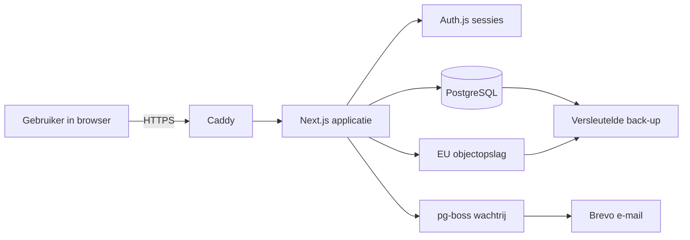

# Ontwikkelplan Beheersysteem Stichting Diligence Almere

**Versie:** 1.1  
**Datum:** 3 november 2026  
**Status:** vastgesteld na goedkeuring; aangevuld met de eis dat voertuigen flexibel beheerbaar zijn  
**Opdrachtgever:** Stichting Diligence Almere  
**Basis:** [`EISEN.md`](EISEN.md), [`AGENTS.md`](../AGENTS.md), de website en het logo van de stichting

> **Wijziging ten opzichte van versie 1.0:** voertuigen zijn geen vaste lijst meer. Een bevoegde medewerker kan altijd een voertuig toevoegen of wijzigen, met naam, kenteken, aantal plekken en opmerkingen. Wat dat betekent voor de automatische toewijzing, bestaande uitjes en de geschiedenis staat in §4.6, §6 en §9.

---

## 1. Managementsamenvatting

De stichting plant elke twee maanden tientallen uitjes voor Almeerse 55-plussers. De opgave gaat telefonisch, de indeling gebeurt nu met de hand en de administratie staat verspreid over papier, Excel en bestaande gegevens. Dat kost tijd, is moeilijk uit te leggen en is gevoelig voor fouten.

Dit plan beschrijft één interne webapplicatie die dat werk ondersteunt:

- deelnemers en groepjes beheren, met import van de bestaande gegevens en een opschoonstap;
- het programma per periode invoeren, onder meer via Excel;
- telefonische opgaven in één scherm vastleggen;
- een eerlijk, deterministisch indelingsvoorstel maken met uitleg in gewone taal;
- de indeling een maand naast de huidige werkwijze laten draaien (proefmodus) en de verschillen tonen;
- reservelijst, bellijst, dagoverzicht en vervoer afhandelen;
- alles vastleggen in een onveranderlijk wijzigingsoverzicht.

De applicatie is bereikbaar in de browser, werkt op tablet, laptop en telefoon, en vraagt geen installatie. Deelnemers krijgen bewust geen login. De eerste bouwronde volgt de volgorde die de opdrachtgever al heeft vastgelegd: deelnemers, uitjes en programma, opgave, indeling met proefmodus, reservelijst en bellijst. Chauffeurskosten, kas en de AI-assistent zijn voorbereid als module maar worden in versie 1 niet gebouwd.

De planning is 18–22 weken voor één ervaren ontwikkelaar, inclusief buffer, gevolgd door een proefmaand. Met twee ontwikkelaars is 12–14 weken haalbaar. De belangrijkste risico's zijn het ontbreken van de echte exportbestanden en de bezoekgeschiedenis, en het nog niet volledig bevestigde indelingsalgoritme. Beide zijn vóór de betreffende bouwfase op te lossen.

---

## 2. Context en opdracht

### 2.1 De stichting

Stichting Diligence Almere organiseert uitjes binnen en buiten Almere voor alle 55-plussers die in Almere wonen. De website noemt musea, exposities, markten, tuincentra, rondvaarten en uit eten. De uitjes gaan met twee comfortabele Mercedes-busjes, elk voor zeven gasten plus chauffeur en begeleider. Elke twee maanden verschijnt een nieuw programma; opgave gaat telefonisch of per e-mail. De stichting is bereikbaar op 036-2022044, info@diligence-almere.nl, Bolderweg 1, 1332 AX Almere.

Die context verklaart de eisen: capaciteiten van 7, 14 en 40, telefonische opgave, belang van de bellijst, en de wens dat vrijwilligers niet meer werk krijgen dan nu.

### 2.2 Het huidige proces

Het programma wordt samengesteld en gepubliceerd. Deelnemers bellen of mailen; de medewerker zoekt de persoon op, noteert de opgave en houdt bij wie wat heeft gekozen. Na de deadline wordt met de hand ingedeeld, met aandacht voor nieuwe deelnemers, groepjes, herhaalde uitjes en de vraag wie vaak meegaat. Daarna worden mensen gebeld over plaatsing of reservering. De bezoekgeschiedenis staat in een bestaande database zonder einddatums bij gestopte deelnemers, waardoor iedereen actief lijkt.

### 2.3 Doel van het systeem

Het systeem is een hulpmiddel, geen beslisser. Het doet een voorstel dat eerlijker en beter uitlegbaar is dan de huidige werkwijze, maar de coördinator houdt altijd het laatste woord. Het systeem mag voor niemand meer werk of minder plezier opleveren. Daarom: grote knoppen, gewone taal, zo weinig klikken als mogelijk, en een proefmaand waarin niets automatisch wordt bevestigd of verstuurd.

### 2.4 Ontwerpprincipes

1. **Eenvoud gaat boven slim.** Een vrijwilliger van 70 moet een scherm kunnen begrijpen zonder uitleg.
2. **Gewoon Nederlands.** Geen jargon, geen Engelse termen in de interface. Code en commits zijn Engels.
3. **Uitlegbaar.** Elke plaatsing en afwijzing heeft een reden in gewone taal.
4. **Deterministisch.** Dezelfde invoer geeft altijd dezelfde uitkomst; er wordt niet geloot.
5. **Rechten op de server.** De UI verbergt, de server beslist.
6. **Nooit stil iets belangrijks.** Bevestigen, waarschuwen en "Ongedaan maken" waar dat kan.
7. **Geen deelnemerlogin.** De applicatie is intern; deelnemers zijn gegevens, geen gebruikers.
8. **EU en AVG.** Hosting, e-mail en back-ups binnen de EU; dataminimalisatie en vastgelegde grondslagen.

---

## 3. Scope

### 3.1 Versie 1 (kern)

| Onderdeel | Eisen | Toelichting |
|---|---|---|
| Deelnemers | 1.1–1.11 | Naam, meerdere telefoons, gestructureerd adres, contactvoorkeur, kaarten, mobiliteit, noodcontact, status met einddatum en reden, duplicaatwaarschuwing, AVG-functies |
| Zoeken | 1.2, 2.5 | Snel zoeken op (deel van) naam met typefouten en op telefoonnummer; groepje zichtbaar |
| Groepjes | 2.1–2.5 | Eenmalig koppelen, als geheel behandelen, maximaal één groepje per persoon, ontbinden met bevestiging en undo |
| Periodes en uitjes | 3.1–3.17 | Periode, uitje, reeks, capaciteit, annuleren, afronden, labels, programma-import, sjabloon, export/print, dagoverzicht |
| Opgave | 4.1–4.7, 4.9–4.11 | Eén scherm, specifiek of alle uitjes, groepje automatisch, bevestigingsregel, deadline, waarschuwing bij rollator; 4.8 is alleen een veld |
| Eerlijke indeling | 5.1–5.17 | Voorstel, uitleg, handmatig, proefmodus, verschillenoverzicht, garantie, deelname-overzicht |
| Reservelijst | 7.1–7.6 | Volgorde, bellijst, status, handmatige aanpassing |
| Bellijst | 5.9, 5.12–5.14, 7.2–7.5 | Bericht, status, één klik, e-mail en telefoon volgens voorkeur |
| Vervoer | 6.1–6.6 | Voertuigen flexibel beheren, automatisch koppelen, handmatig toevoegen, dubbele boeking voorkomen, chauffeur koppelen, deelnemers per voertuig verdelen |
| Gebruikers en rollen | 9.1–9.8 | Accounts, standaardrollen, eigen rollen, rechten per handeling, 2FA, wachtwoord vergeten, uitschakelen, sessiebeleid |
| Wijzigingsoverzicht | 10.1–10.5 | Wie, wanneer, wat, oud en nieuw, filters, gewone taal, invoeg-only |
| Hulp en feedback | 11.1, 11.2, 15.1, 15.2 | Hulppagina's, stappenplannen, feedbackknop en overzicht |
| Gebruiksvriendelijkheid | 12.1–12.10 | WCAG 2.2 AA, grote knoppen, gewone taal, volgende stap, bevestiging, undo, lege schermen, responsief, taak van het moment, concept bewaren |
| Techniek en beveiliging | 13.1–13.9 | Webapp, EU-hosting, HTTPS, versleuteling, back-up, testomgeving, import, opschonen, export, rapportages, privacyverklaring |
| Modules | 14.1–14.7 | Modulemechanisme, kern altijd aan, optionele modules onzichtbaar en onbereikbaar, gegevens blijven bewaard |
| Invoering | 15.3, 15.4 | Uitrol in stappen en testen met echte vrijwilligers |

### 3.2 Fase 2

| Onderdeel | Eisen | Reden |
|---|---|---|
| Chauffeurskosten | 8.1–8.8 | Besluit 19: eerst de kern, geld op hold |
| Kas | 8.9–8.14 | Vereist chauffeurskosten; aparte module |
| AI-assistent | 11.3, 11.4 | Module bestaat en staat uit; inhoud volgt na keuze leverancier en DPIA |
| Routeplanning | 6.7 | Bewust later; adres wordt al gestructureerd opgeslagen |
| Chauffeursbeschikbaarheid | 6.10 | Later; in versie 1 wijst de coördinator toe |
| SMS | 7.6 | Optioneel en later; bellen is de hoofdroute |
| "Wat is er nieuw" | 15.5 | Kan later |

### 3.3 Buiten scope

- Een login of online opgave voor deelnemers.
- Online betalen door deelnemers.
- Volledig voertuigbeheer: kilometerstanden, onderhoud, schade (6.8 is W).
- Ophaalroutes berekenen (6.9 is W).
- De modules `expenses`, `cash` en de inhoud van `assistant` in versie 1.
- Een publieke website of deelnemersportaal.

### 3.4 Conflicten en gemaakte keuzes

| Conflict | Keuze |
|---|---|
| 14.3 noemt chauffeurskosten, kas en AI als optionele modules in versie 1; Besluit 19 en `AGENTS.md` zeggen: kern eerst, geld op hold | Versie 1 bouwt het modulemechanisme en de rol, maar niet de inhoud van chauffeurskosten en kas. De AI-module staat uit. Dit is met de opdrachtgever te bevestigen; anders 6–8 weken extra |
| 6.8 "voertuigbeheer" is W, maar 6.1 vraagt voertuigen als objecten | Een **basisvoertuigregister** (toevoegen, wijzigen, archiveren, aantal plekken, kenteken) hoort bij versie 1. Kilometerstanden, onderhoud en schade blijven buiten scope |
| 3.17 is S, maar de dagelijkse werking leunt erop | Dagoverzicht en deelnemerslijst per uitje worden in versie 1 gebouwd |
| 5.17 is S, maar de proefmaand vraagt om bestaande opgaven | Opgavenimport wordt in versie 1 gebouwd |
| 1.10 is S, maar de deelnemerslijst heeft kaarten nodig | Kaarten worden in versie 1 meegenomen |
| 4.8 is C (notitie bij opgave) | Het veld komt in het datamodel; het scherm alleen als het de eenvoud niet schaadt |

---

## 4. Architectuur en techniek

### 4.1 Uitgangspunten

- **Modulaire monoliet.** Eén applicatie, intern opgedeeld in modules met een kleine publieke service-API. Geen microservices; dat is voor deze omvang en dit beheerdersteam onnodig complex.
- **Server-side waar het telt.** Schermen worden server-side gerenderd; persoonsgegevens komen niet in een clientcache. Rechten worden altijd op de server gecontroleerd.
- **Pure domeinlogica.** De indelingsmotor is een pure functie: invoer erin, voorstel eruit. Geen database, geen `Date.now()`, geen `Math.random()`.
- **Alles vastgelegd.** Elke wijziging loopt via één route: rechtencontrole → validatie → transactie → wijzigingsoverzicht → optioneel undo-token.
- **EU-first.** Hosting, e-mail, objectopslag en back-ups binnen de EU.

### 4.2 Stack

| Laag | Keuze | Toelichting |
|---|---|---|
| Taal | TypeScript (strict) | Eén taal voor domein, validatie en schermen; de indelingsregels zijn hard te testen |
| Framework | Next.js (App Router), React, server-side rendering | Snelle, eenvoudige schermen; geen zware client-app; goede mobiele ondersteuning |
| Database | PostgreSQL 16 of hoger | Relationele data, trigram-zoekopdrachten, strikte constraints |
| ORM | Drizzle ORM met migraties | Typeveilig, transparant, past bij de gekozen structuur |
| Validatie | Zod | Dezelfde schema's server- en client-side |
| Inloggen | Auth.js met database-sessies, Argon2id, TOTP als tweede stap, e-mailcode als alternatief | Past bij `AGENTS.md`; geen eigen sessieprotocol; 2FA blijft maatwerk |
| UI | Tailwind CSS, Radix-primitieven, eigen tokens | Toegankelijke dialogen en comboboxen, zonder kleine standaardletters |
| E-mail | Brevo (Frankrijk, EU), React Email, wachtrij via pg-boss | EU-verwerking, eigen afzenderdomein, vertraagde verzending voor undo |
| Bestanden | ExcelJS, print-CSS | Import/export en print zonder headless browser |
| Tests | Vitest, Playwright, axe | Domein, schermen en toegankelijkheid |
| Foutmonitoring | Sentry EU of zelfgehost | Geen persoonsgegevens in events |
| Hosting | Nederlandse VPS, Docker Compose, Caddy, EU-objectopslag | EU-data, HTTPS, eenvoudig beheer |
| CI | GitHub Actions | Lint, typecheck, tests, migratiecontrole, deploy naar test |

De exacte versies worden in M0 vastgezet in een lockbestand. Nieuwe afhankelijkheden worden per wijziging beoordeeld; `AGENTS.md` vraagt daarvoor eerst toestemming.

### 4.3 Waarom deze stack

Laravel en Django zijn overwogen. Laravel is sneller voor standaard-CRUD en heeft veel kant-en-klare voorzieningen, maar de kern van dit systeem bestaat uit fijnmazige rechten, import en een deterministisch algoritme. Die zijn in TypeScript met gedeelde schema's beter af te dekken, en dezelfde taal geldt voor server en schermen. Django biedt een sterke admin, maar de gebruikerservaring voor niet-digitale vrijwilligers vraagt toch een eigen UI, waardoor het voordeel kleiner wordt.

De definitieve keuze wordt in M0 vastgelegd als Architecture Decision Record (ADR-001), samen met ADR-002 (Auth.js en 2FA), ADR-003 (modulaire monoliet), ADR-004 (versleuteling), ADR-005 (audit hash-keten), ADR-006 (voertuigcapaciteit en snapshots) en ADR-007 (hosting).

### 4.4 Systeemoverzicht



- **Caddy** regelt TLS en is de enige poort naar buiten.
- **Next.js** bevat schermen, server actions, rechten, import en de indelingsmotor.
- **PostgreSQL** is de bron van waarheid, inclusief sessies, wachtrij en audit.
- **pg-boss** verwerkt e-mail en langere taken; geen extra Redis-dienst nodig.
- **Brevo** verstuurt transactionele e-mail via een eigen afzenderdomein.
- **Objectopslag** bewaart back-ups en later bonnetjes; in versie 1 alleen back-ups.

### 4.5 Projectstructuur

```
src/app/                 pagina's en routes
src/domain/              zuivere bedrijfslogica, geen database of UI
  allocation/            eerlijke indeling
  waitlist/              reservelijst
  groups/                groepjes
src/server/              database, auth, rechten, audit log
  audit/
  auth/
  permissions/
src/components/          UI-componenten
src/modules/             optionele modules
  expenses/
  cash/
  assistant/
public/brand/            logo en favicon
tests/                   e2e en testdata
docs/                    eisen, plan, besluiten, help
```

- De kern importeert niets uit `src/modules/*`.
- Elke optionele module heeft een eigen map, eigen tests en schakelt via één centrale module-instelling.
- Een uitgezette module is onzichtbaar en onbereikbaar via menu, route én API; de gegevens blijven bewaard.
- Domeinwoorden volgen de afspraken in `AGENTS.md`: `participant`, `outing`, `period`, `group`, `waitlist`, `allocation`, `signup`, `driver`, `audit log`.

### 4.6 Voertuigen: flexibel beheer

Voertuigen zijn geen vaste lijst. Er staat geen busje of touringcar hard in de code: de huidige voertuigen worden bij de inrichting eenmalig toegevoegd en zijn daarna vrij aanpasbaar. Een bevoegde medewerker (Admin, Beheerder of Coördinator) kan altijd:

- een voertuig toevoegen;
- de naam wijzigen;
- het kenteken wijzigen;
- het aantal plekken wijzigen;
- een opmerking toevoegen;
- een voertuig archiveren (nooit hard verwijderen).

**Velden:** naam, kenteken, aantal plekken, actief, opmerkingen, aangemaakt/aangepast door en op. Het kenteken wordt genormaliseerd (hoofdletters, zonder spaties en streepjes) voor vergelijking en uniekheid onder actieve voertuigen. Een kentekenwijziging en een capaciteitswijziging komen in het wijzigingsoverzicht.

**Wat er gebeurt bij wijzigingen:**

- Een capaciteitswijziging geldt voor **nieuwe** toewijzingen. Bestaande uitjes houden een snapshot van het aantal plekken en het kenteken zoals ze op dat moment waren, zodat daglijsten en prints van vroeger niet met terugwerkende kracht veranderen.
- Het systeem waarschuwt bij toekomstige uitjes waar het voertuig is ingedeeld en de nieuwe capaciteit niet meer past. Het past niets stil aan; de coördinator kan de koppeling opnieuw laten berekenen.
- Het aantal plekken mag per uitje tijdelijk afwijken (bijvoorbeeld een stoel minder). Dat wordt als snapshot bij die uitje vastgelegd; de vraag of dit in versie 1 een eigen scherm krijgt, staat in §15.2.
- Een voertuig dat op dezelfde dag al voor een ander uitje is geboekt, kan niet nog eens worden geboekt (6.4).
- Archiveren maakt het voertuig onselecteerbaar voor nieuwe uitjes, maar laat historische koppelingen intact.

**Automatische koppeling (6.2):** bij het aanmaken of wijzigen van een uitje stelt het systeem een combinatie voor uit de actieve, die dag vrije voertuigen. Het voorstel kiest de combinatie met zo weinig mogelijk lege plekken; bij gelijke uitkomst eerst zo weinig mogelijk voertuigen, daarna een vaste sortering op naam en id. Past niets, dan waarschuwt het systeem en blijft handmatig toevoegen mogelijk. De coördinator kan altijd afwijken.

**Handmatig toevoegen (6.3):** de coördinator kan een voertuig toevoegen. De capaciteit van het uitje wordt daarbij voorgesteld als de som van de toegewezen plekken, maar blijft aanpasbaar. Het systeem waarschuwt als de uitjescapaciteit groter is dan het totaal aantal plekken.

**Wat níet in versie 1 zit:** kilometerstanden, onderhoud, schade, brandstof en voertuigkosten. Die horen bij 6.8 (W) en bij de latere module Chauffeurskosten.

### 4.7 Omgevingen

| Omgeving | Doel | Data |
|---|---|---|
| Lokaal | Ontwikkelen en testen | Verzonnen seeddata |
| Test | Demo, UAT, migraties oefenen | Nepdata, aparte database, basisbeveiliging |
| Productie | Echte vrijwilligers | Echte gegevens, versleuteld en geback-upt |

Echte persoonsgegevens komen nooit in de testomgeving, screenshots, seeds of voorbeelden (13.5). Testdata gebruikt verzonnen namen.

### 4.8 Belangrijkste gegevensstromen

1. **Opgave:** zoeken → deelnemer kiezen → uitjes aanvinken → controle groepje → opslaan → bevestigingsregel → audit.
2. **Import:** bestand → normaliseren → valideren → preview met fouten → bevestigen → transactie → batch-id → undo.
3. **Indeling:** invoer verzamelen → pure functie → voorstel met uitleg → handmatige aanpassing → proefmodus of bevestigen → bellijst en e-mails.
4. **Dag van het uitje:** dagoverzicht printen → chauffeur en busjes → aanwezigheid registreren → bezoekgeschiedenis bijwerken.
5. **Wijziging:** rechten → validatie → transactie → audit-event → bevestiging met undo.

---

## 5. Huisstijl en toegankelijkheid

### 5.1 Logo

Het logo staat in [`assets/logo-diligence-almere.jpg`](assets/logo-diligence-almere.jpg) en is afkomstig van [diligence-almere.nl](https://www.diligence-almere.nl/). Het is een JPEG van 1228 × 874 px, 180 KB, met een witte achtergrond en de kleuren #20201E (zwart) en #C20116 (rood). Het blijft ongewijzigd: niet uitrekken, niet herkleuren, voldoende witruimte.

| Toepassing | Maat |
|---|---|
| Header | 56–64 px hoog, linksboven |
| Inlogpagina | maximaal 280 px breed, gecentreerd op wit |
| Hulp- en contactpagina | 200–240 px breed |
| Print | ongeveer 40 mm breed, zwart-rood op wit |
| Favicon | vierkante uitsnede met witte rand |

Alt-tekst: "Logo Stichting Diligence Almere". Een vectorversie (SVG/EPS/PDF) wordt opgevraagd voor groot printwerk; de huidige JPEG is voor scherm en 40 mm print voldoende.

### 5.2 Kleuren

| Token | Waarde | Gebruik |
|---|---|---|
| Accent | `#C20116` | Primaire knoppen, links, actieve tab; witte tekst |
| Accent hover | `#A00112` | Hover en active |
| Tekst | `#20201E` | Koppen en body |
| Secundaire tekst | `#4D4D4D` | Hulptekst |
| Pagina-achtergrond | `#F6F6F6` | Rustige achtergrond |
| Oppervlak | `#FFFFFF` | Header, kaarten, formulieren |
| Rand | `#C3C3C3` | Scheidslijnen en veldranden |
| Succes | `#1E6B3A` | Alleen met tekst en icoon |
| Waarschuwing | `#8A5A00` | Alleen met tekst en icoon |
| Fout | `#B3261E` | Alleen met tekst en icoon |

Wit op `#C20116` haalt circa 6,3:1 contrast en is daarmee AA voor normale tekst. De tokens worden in M0 met een contrasttest en een visuele controle vastgelegd. Er is **één accentkleur**, zoals `AGENTS.md` voorschrijft; het groenblauw van de website wordt niet als tweede accent gebruikt.

### 5.3 Typografie en componenten

- Systeemlettertypen, geen externe fontdienst. Basistekst 20 px, regelhoogte 1,6; koppen 24–32 px; knoppen 18–20 px.
- Knoppen minimaal 48 px hoog, met tekstlabel; nooit een los icoon als enige betekenis.
- Formuliervelden minimaal 48 px hoog, met een altijd zichtbaar label en hulptekst waar nodig.
- Focus is duidelijk zichtbaar (3 px, niet alleen kleur), ook op de accentkleur.
- Foutmeldingen staan bij het veld én in een samenvatting boven het formulier, met een link naar het veld.
- Geen dark mode in versie 1, omdat er geen transparante of witte logoversie is. Wel wordt `prefers-contrast` gerespecteerd.

### 5.4 Schermpatronen

- Bovenaan elk scherm staat in één zin wat de gebruiker nu moet doen.
- Na elke actie een bevestiging, met "Ongedaan maken" waar dat kan.
- Gevaarlijke acties (verwijderen, indeling bevestigen, e-mails versturen) vragen om bevestiging met uitleg van het gevolg.
- Lege schermen leggen uit wat de volgende stap is.
- Concepten worden bewaard als de pagina per ongeluk sluit (12.10).
- Uitloggen bij inactiviteit: standaard 60 minuten, met een waarschuwing ruim vooraf; instelbaar, zodat een bellende medewerker niet midden in een gesprek wordt uitgelogd.
- De startpagina toont de taak van het moment: opgave invoeren tijdens de opgaveperiode, indeling bekijken na de deadline, bellijst afwerken na bevestiging.

### 5.5 Toegankelijkheid

WCAG 2.2 AA is de ondergrens. Concreet:

- contrast minimaal 4,5:1 voor normale tekst en 3:1 voor grote tekst;
- 200% zoom zonder verlies van inhoud of functie;
- 360 px breed zonder horizontaal scrollen;
- toetsenbordbediening voor alle functies, logische focusvolgorde, geen focusval;
- schermlezerlabels, koppenstructuur, taal `nl-NL`, skip-link;
- fouten identificeren en uitleggen, niet alleen kleur;
- geen cognitieve test bij inloggen; tweestapsverificatie met een toegankelijk alternatief;
- tijdslimieten verlengbaar of uitschakelbaar;
- bewegende content beperkt zich tot wat nodig is en respecteert `prefers-reduced-motion`;
- testen met echte oudere vrijwilligers, niet alleen geautomatiseerd.

### 5.6 Hulp en feedback

Per scherm staat een zichtbare knop **Hulp** met korte stappenplannen en schermafbeeldingen van de vijf à zes hoofdtaken. Daarnaast staat er een knop **Iets onduidelijk of werkt het niet goed?** waarmee een vrijwilliger in een paar woorden feedback geeft; het systeem legt het scherm en de gebruiker vast. De Beheerder ziet de feedback in een overzicht met de status nieuw, in behandeling of afgehandeld.

---

## 6. Domeinmodel

De volledige uitwerking staat in [`DATAMODEL.md`](DATAMODEL.md). De belangrijkste eenheden:

| Eenheid | Kern |
|---|---|
| Deelnemer | Persoon, meerdere telefoons, adres, contactvoorkeur, kaarten, mobiliteit, status, noodcontact; nooit hard verwijderen |
| Groepje | Vaste leden, maximaal één actief groepje per deelnemer; ontbinden is terug te draaien |
| Periode | Datumbereik met opgavedeadline en status concept/gepubliceerd/gesloten |
| Uitje | Datum, tijd, omschrijving, prijs, extra kosten, labels, capaciteit, geschiktheid; kan deel zijn van een reeks |
| Opgave | Deelnemer wil mee met een specifieke datum, een reeks (één keer) of alle uitjes van de periode; met groepje of alleen |
| Indeling | Voorstel of bevestigde toewijzing per uitje, met status, rang, bron en uitleg |
| Reservelijst | Geordende wachtlijst per uitje, met belflow |
| Voertuig | Flexibel object met naam, kenteken, aantal plekken en actief-status |
| Bericht | E-mail of beltaak, met status en zonder gevoelige inhoud |
| Wijziging | Append-only event met oude en nieuwe waarde en een leesbare samenvatting |

**Invarianten:**

- een deelnemer heeft maximaal één actief groepje;
- status "gestopt" vereist een einddatum en reden;
- een voertuig is niet twee keer op dezelfde dag geboekt;
- een deelnemer gaat per reeks maximaal één keer mee;
- capaciteit wordt automatisch nooit overschreden; handmatig mag met waarschuwing;
- een groepje wordt automatisch nooit gesplitst;
- niets wordt hard verwijderd; archiveren of anonimiseren;
- het wijzigingsoverzicht is niet te wijzigen of te verwijderen.

---

## 7. Eerlijke indeling

De volledige uitwerking staat in [`INDELINGSALGORITME.md`](INDELINGSALGORITME.md). Dit is het hart van versie 1 en het onderdeel waar de meeste zorg naartoe gaat.

**Vastgelegd in de eisen en besluiten:**

1. Specifieke opgave gaat voor "alle uitjes" (Besluit 1).
2. Nieuw is: nog nooit meegeweest; een reservering of opgave telt niet als deelname (Besluit 4).
3. De garantie van twee uitjes geldt over periodes heen, voor zover er ruimte is (Besluit 5).
4. "Vaak geweest" telt over alle uitjes samen, in de laatste 12 maanden; ouder telt niet mee voor de score, maar blijft in de geschiedenis (Besluit 6 en 7).
5. Bij gelijke stand gaat de persoon die het langst niet meedeed voor; is ook dat gelijk, dan beslist de coördinator, niet het systeem (Besluit 8).
6. De score van een groepje is het gemiddelde van de leden; groepjes worden alleen compleet geplaatst (Besluit 9).
7. Wie zich voor alle data van een reeks opgeeft, wil één keer mee; het systeem kiest de datum waar de meeste ruimte is (Besluit 10).
8. Wie in een groepje zit, kan per uitje "Alleen" kiezen; dan telt het groepje niet mee (Besluit 11).
9. De coördinator kan altijd handmatig ingrijpen; het systeem waarschuwt, maar blokkeert niet (Besluit 2).
10. De uitkomst is deterministisch en elke plek heeft uitleg in gewone taal (5.4, 5.5).

**Nog niet bevestigd, dus niet bouwen zonder besluit:**

- de exacte volgorde en weging tussen vaste datum, garantie, frequentie en groepjes;
- of de garantie telt op basis van bevestigde plaatsingen of echte aanwezigheid;
- de betekenis van "alle uitjes" (voorstel: één plek per uniek uitje per periode, bij een reeks één datum);
- het gedrag als een groepje niet past;
- de wachtlijstdatum voor een flexibele opgave;
- de presentatie als er meer exact gelijke kandidaten dan plekken zijn.

Deze punten staan in [`INDELINGSALGORITME.md`](INDELINGSALGORITME.md) als `TODO(besluit)`. De motor wordt pas gebouwd nadat de opdrachtgever ze heeft bevestigd. Tot die tijd kunnen schermen en datamodel wel worden voorbereid.

**Proefmodus:** het systeem rekent een voorstel door zonder te bevestigen of te mailen. De handmatige indeling wordt in hetzelfde scherm of via import vastgelegd. Het verschiloverzicht toont per uitje en per persoon wie anders is ingedeeld, met de uitleg en de deelnamecijfers. Na de proefmaand volgt een expliciet go/no-go.

---

## 8. Import, export en print

De volledige uitwerking staat in [`IMPORTSPECIFICATIE.md`](IMPORTSPECIFICATIE.md).

**Programma-import:** maandkoppen, dagregels, tijden, bedragen, labels, extra kosten, capaciteit en geschiktheid. Vóór opslaan een controlescherm met fouten in gewone taal; daarna één transactie en een undo. Een reeks mag over twee maanden lopen. De huidige publieke programma's staan als JPEG-posters op de website; het echte Excel/CSV-werkbestand moet vóór M2 worden opgevraagd.

**Deelnemersimport:** controle vooraf, duplicaten, adres, contactvoorkeur, kaarten, mobiliteit, statussen en de bezoekgeschiedenis van de laatste 12 maanden. Daarna een beoordelingslijst voor mensen die lang niet meegingen: actief houden, pauzeren of archiveren, nooit automatisch verwijderen.

**Opgavenimport:** voor de proefmaand, met dezelfde preview en undo.

**Export en print:** programma als Excel en printbare PDF in de huisstijl, deelnemerslijst en dagoverzicht per uitje, bellijst en beheerder-export. Print-CSS zonder aparte PDF-dienst.

---

## 9. Rollen, rechten, modules en wijzigingsoverzicht

### 9.1 Rollen en rechten

Rechten worden per onderdeel en per handeling ingesteld: zien, aanmaken, wijzigen, archiveren en bevestigen. De server controleert altijd, ook als een knop niet zichtbaar is. Er wordt nooit op rolnaam gecontroleerd, alleen op recht.

| Onderdeel | Admin | Beheerder | Coördinator | Chauffeur | Penningmeester |
|---|---|---|---|---|---|
| Deelnemers | ja | ja | ja | eigen uitjes, beperkte velden | nee |
| Groepjes | ja | ja | ja | nee | nee |
| Periodes en uitjes | ja | ja | ja | eigen uitjes zien | nee |
| Opgaven | ja | ja | ja | nee | nee |
| Indeling | ja | ja | ja | nee | nee |
| Reservelijst en bellen | ja | ja | ja | nee | nee |
| Voertuigen | ja | ja | ja | eigen uitje zien | nee |
| Chauffeur koppelen | ja | ja | ja | nee | nee |
| Gebruikers en rollen | ja | ja | nee | nee | nee |
| Instellingen | ja | ja | nee | nee | nee |
| Modules aan/uit | ja | nee | nee | nee | nee |
| Wijzigingsoverzicht | lezen | lezen | operationeel, beperkt | nee | nee |
| Feedback | ja | ja | eigen invoer | eigen invoer | eigen invoer |
| Declaraties en kas | ja | ja | nee | eigen declaraties (fase 2) | ja (fase 2) |

- **Chauffeur:** ziet alleen zijn eigen uitjes en de voor hem noodzakelijke deelnemersgegevens (naam, telefoon, groepje, kaarten, mobiliteit, opstapadres). Geen notities, noodcontact of volledige administratie.
- **Penningmeester:** de rol staat klaar, maar zonder de module `expenses` ziet hij in versie 1 geen declaraties. In fase 2 krijgt de rol inhoud.
- **Eigen rollen:** Admin en Beheerder kunnen rollen maken en rechten toekennen. Niemand kan meer rechten geven dan hij zelf heeft. Standaardrollen zijn niet te verwijderen.

### 9.2 Modules

| Module | Sleutel | Versie 1 | Afhankelijkheid |
|---|---|---|---|
| Chauffeurskosten | `expenses` | Alleen mechanisme | — |
| Kas | `cash` | Alleen mechanisme | `expenses` |
| AI-assistent | `assistant` | Alleen mechanisme, staat uit | Geen deelnemersgegevens |

- Alleen de Admin zet modules aan of uit (Besluit 20).
- Uit betekent: menu's, schermen en rechten onzichtbaar en via de URL geblokkeerd; gegevens blijven bewaard.
- Aanzetten of uitzetten kan zonder gegevensverlies; elke wijziging komt in het wijzigingsoverzicht.
- De kern is nooit afhankelijk van een optionele module.
- `cash` kan alleen aan als `expenses` aan staat (14.6).

### 9.3 Wijzigingsoverzicht

Elke wijziging legt vast: wie, wanneer, wat, oude en nieuwe waarde, en een regel in gewone taal. Bijvoorbeeld: "Els heeft Jan de Vries afgemeld voor Efteling op 3 maart." Het overzicht is filterbaar op persoon, medewerker, uitje en datum. Het is invoeg-only, afgedwongen met een database-trigger en een aparte database-rol, en voorzien van een hash-keten. "Ongedaan maken" is een nieuwe tegenboeking, geen wijziging van het verleden. Inzage in persoonsgegevens wordt apart gelogd (10.4).

---

## 10. Beveiliging, privacy en AVG

### 10.1 Inloggen en sessies

- Auth.js met database-sessies; wachtwoorden met Argon2id.
- Tweestapsverificatie verplicht voor Admin en Beheerder, met herstelcodes.
- E-mailcode als alternatief voor vrijwilligers die geen app willen gebruiken.
- Zelfbediening voor wachtwoord vergeten, met een beperkte geldigheid en rate limiting.
- Sessies: beveiligde, HttpOnly-cookies, CSRF-bescherming, absoluut 8 uur, inactief 60 minuten met waarschuwing, direct intrekbaar bij uitschakelen van een account.
- Na de eerste login blokkeert de applicatie alles behalve de tweestapspagina tot de tweede factor is bevestigd.

### 10.2 Gegevensbescherming

- TLS 1.2 of hoger; versleutelde schijf bij de host.
- Gevoelige velden (telefoon, e-mail, notities, noodcontact) apps-versleuteld met AES-256-GCM en een eigen sleutel per deelnemer onder een hoofdsleutel.
- Telefoonzoeken kan exact via een blinde index (HMAC); namen blijven doorzoekbaar met trigrammen, omdat fuzzy zoeken op versleutelde tekst niet kan. Deze afweging staat in de DPIA.
- Geen persoonsgegevens in logbestanden, foutmeldingen, URL's, e-mails of de AI-assistent.
- Inzage in persoonsgegevens wordt gelogd.
- Geen echte gegevens in tests, seeds, screenshots of voorbeelden.

### 10.3 Mobiliteit en gezondheid

Rollator, rolstoel en hulp bij instappen kunnen een gezondheidsgegeven zijn. Daarom: een DPIA vóór livegang, beperkte toegang, versleuteling, niet in e-mails, en een expliciete grondslag in de privacyverklaring. De indeling rekent niet met mobiliteit (Besluit 21); het systeem waarschuwt alleen bij een uitje dat "minder geschikt voor rollators" is.

### 10.4 AVG-rechten en bewaartermijnen

- Inzage-overzicht per persoon en export.
- Anonimiseren op verzoek: naam en adres vervangen, versleutelde velden onleesbaar maken door de persoonssleutel te vernietigen, deelnamestatistieken zonder identiteit bewaren.
- Bewaartermijn voor gestopte deelnemers en voor de opschoonlijst, in te stellen door de Beheerder.
- Verwerkingsregister, privacyverklaring en verwerkersovereenkomsten met host en e-mailprovider vóór livegang.
- E-mails: alleen noodzakelijke gegevens, duidelijke afzender, afmeldmogelijkheid, elke verzending in het wijzigingsoverzicht.

### 10.5 Back-ups en herstel

- Dagelijks versleuteld, 30 dagen dagelijks en 12 maanden maandelijks, offsite in de EU.
- Kwartaal een geteste terugzetting; hersteltijd maximaal 4 uur.
- De sleutel wordt buiten de server bewaard.

### 10.6 Overig

Securityheaders, CSP, rate limiting, dependency-audits, geen productiedata in test, voor livegang een externe penetration test of minimaal een gestructureerde security-review, en een kort incidentplan met wie wat doet.

---

## 11. Hosting, CI/CD en beheer

### 11.1 Productie

- Nederlandse VPS, Docker Compose met app, PostgreSQL en Caddy.
- Automatische HTTPS via Caddy, SSH met sleutels, firewall, unattended upgrades, fail2ban.
- Voorgestelde URL: `beheer.diligence-almere.nl`, te bevestigen met de domeineigenaar.
- Eén applicatie-instantie; de wachtrij draait in dezelfde container. Dat is voor deze omvang voldoende.

### 11.2 Test

- Aparte stack of kleine VPS met nepdata en eigen database.
- Nooit een kopie van productie.
- Basistoegang voor de testers; geen echte gegevens.

### 11.3 Back-up en monitoring

- Versleutelde `pg_dump` naar EU-objectopslag via een aparte cron.
- Uptime, schijfruimte en foutmeldingen zonder persoonsgegevens.
- Maandelijkse controle van back-ups; kwartaal een echte hersteltest.

### 11.4 CI/CD

Bij elke pull request: lint, typecheck, unit tests, Playwright, axe, migratiecontrole en dependency-audit. Deploy naar test automatisch; naar productie met één handmatige goedkeuring. Migraties worden eerst op test gedraaid.

### 11.5 Kosten (indicatief)

| Post | Per maand |
|---|---|
| VPS en back-upopslag | € 25–60 |
| E-mail | € 0–30 |
| Domein | € 1–2 |
| Monitoring | € 0–25 |
| **Totaal** | **€ 40–90** |

Eenmalig € 0–500 voor een security-review. De opdrachtgever is eigenaar van domein, hostingaccount en back-upsleutel.

---

## 12. Planning en mijlpalen

Uitgangspunt: één ervaren full-stack ontwikkelaar, met deels een ontwerper/toegankelijkheidsspecialist en een productowner vanuit de stichting. De volgorde volgt Besluit 18, 19 en `AGENTS.md`.

| Fase | Inhoud | Doorlooptijd | Uitgangscriterium |
|---|---|---|---|
| M0 | Beslissingen, hosting, repo, CI, ontwerptokens met logo, datamodel, dreigingsmodel, DPIA-start, echte invoerbestanden ophalen | 2 weken | Technische basis staat; logo en kleuren vastgelegd; invoerbestanden geanalyseerd |
| M1 | Inloggen, rollen/rechten, audit, deelnemers, groepjes, zoeken, deelnemersimport, opschonen, AVG-basis | 4 weken | Deelnemer zoeken en importeren werkt; rechten en audit getest; logo op alle kernschermen |
| M2 | Periodes, uitjes, reeksen, voertuigen, programma-import met preview en undo, export/print | 3 weken | 21 uitjes importeren, controleren, terugdraaien en printen; voertuig toevoegen en wijzigen werkt |
| M3 | Telefonische opgave, deadline, bevestigingsregel, opgavenimport | 2,5 weken | Opgave voor individu en groepje, met audit en deadlineblokkade |
| M4 | Indelingsmotor, uitleg, handmatig aanpassen, proefmodus, verschillenoverzicht, reservelijst, bellijst, e-mails | 5 weken | Regelsessie afgerond; gouden tests groen; proefronde zonder verzending; verschilrapport compleet |
| M5 | Voertuigtoewijzing, dagoverzicht, startpagina per rol, hulp, feedback, UX- en toegankelijkheidshardening | 2,5 weken | Daglijst op telefoon; axe-scan schoon op kernschermen; print met logo |
| M6 | Security-review, penetratietest, UAT met vrijwilligers, livegang | 2 weken | Acceptatietests en hersteltest geslaagd |

**Totaal:** circa 18–22 weken voor één ontwikkelaar, inclusief 15% buffer; met twee ontwikkelaars ongeveer 12–14 weken. Daarna vier weken proefmaand naast de huidige werkwijze, met een expliciet beslismoment. Fase 2 (chauffeurskosten, kas, AI) kost daarna 6–8 weken. **Indicatie:** 700–900 uur voor de kern.

**Kritiek pad:** echte exportbestanden en bezoekgeschiedenis, bevestiging van de indelingsregels, en de beschikbaarheid van de productowner voor demo's en UAT. Zonder die drie loopt de planning vast.

**Team:**

- 1 full-stack ontwikkelaar (lead);
- 0,2 FTE ontwerp/toegankelijkheid;
- productowner vanuit de stichting, ongeveer 4 uur per week;
- 5–10 testvrijwilligers voor de UAT en de proefmaand;
- externe security-reviewer vóór livegang.

---

## 13. Kwaliteit en acceptatie

### 13.1 Teststrategie

| Laag | Wat | Wanneer |
|---|---|---|
| Unit | Indelingsregels, importparsers, rechten, datum- en geldnormalisatie | Bij elke wijziging |
| Integratie | Database, transacties, audit, import en undo | Bij elke wijziging |
| E2E | Hoofdflows in de browser, inclusief mobiel | Bij elke pull request |
| Toegankelijkheid | axe-scan plus handmatige toetsenbord- en schermlezercontrole | Per mijlpaal |
| Security | Rechtenmatrix, 2FA, audit-integriteit, hersteltest | M6 |
| UAT | Echte vrijwilligers voeren de vijf hoofdtaken uit | M6 en proefmaand |

### 13.2 Acceptatiescenario's

1. Zoeken op "JAn de vr" vindt Jan de Vries; zoeken op een telefoonnummer met spaties vindt dezelfde persoon.
2. Een programma met 21 uitjes importeren geeft een preview met 21 regels, fouten per rij, en na bevestigen een undo.
3. Een opgave voor een groepje neemt alle leden mee, toont een bevestigingsregel en staat in het wijzigingsoverzicht.
4. Na de deadline is wijzigen geblokkeerd, behalve met de juiste rol en een reden.
5. De indeling geeft bij dezelfde invoer tweemaal exact hetzelfde voorstel en dezelfde uitleg.
6. Een groepje van drie past niet in een uitje met twee plekken: het gaat als geheel naar de reservelijst en wordt niet gesplitst.
7. Een exacte gelijke stand levert "gelijke stand: coördinator beslist" op, zonder willekeurige keuze.
8. De proefmodus verstuurt geen e-mail en bevestigt niets; het verschiloverzicht toont de verschillen.
9. Een reserverist zegt "kan niet": de volgende komt bovenaan de bellijst, zonder negatieve score.
10. Een chauffeur ziet alleen zijn eigen uitje en de afgesproken velden.
11. Een uitgezette module is via de URL niet bereikbaar en verdwijnt uit het menu.
12. Een voertuig toevoegen met kenteken en aantal plekken werkt; wijzigen van plekken waarschuwt bij toekomstige uitjes en laat oude daglijsten intact.
13. Het logo staat correct op inloggen, header, hulp en print; wit op rood haalt AA.
14. Een back-up terugzetten op test lukt binnen 4 uur.
15. Geen persoonsgegevens in testdata, logs, URL's of e-mails.

### 13.3 Definition of Done

Een wijziging is klaar als:

- de code gereviewd is;
- unit- en integratietests groen zijn;
- `pnpm lint` en `pnpm test` slagen;
- de Nederlandse teksten op B1-niveau zijn nagelezen;
- rechten server-side zijn getest;
- het audit-event bestaat;
- de hulppagina is bijgewerkt;
- de demo aan de productowner is gegeven;
- er geen echte persoonsgegevens in de wijziging zitten.

Elke eis uit `EISEN.md` krijgt een nummer in de traceerbaarheidsmatrix. Aan het einde van elke fase wordt de matrix bijgewerkt.

---

## 14. Risico's

| Risico | Kans | Impact | Maatregel |
|---|---|---|---|
| Echte database-export en 12 maanden geschiedenis ontbreken | Hoog | Hoog | In M0 ophalen en analyseren; anders adapter en tijdelijke proefdata, expliciet als risico melden |
| Programma-Excel wijkt af van het sjabloon | Middel | Hoog | Sjabloon plus adapterlaag, vroege proefimport met het echte bestand |
| Programma staat online als JPEG-poster | Hoog | Middel | Werkbestand opvragen; import template en export/print in dezelfde maandstructuur |
| Indelingsregels blijven onduidelijk | Middel | Hoog | Regelsessie vóór M4; `TODO(besluit)`; geen motor bouwen zonder bevestiging |
| Vrijwilligers vinden het systeem te veel werk | Middel | Hoog | Proefmaand, feedbackknop, hulp per scherm, UAT, modules die uit kunnen |
| Privacy rond mobiliteit en notities | Middel | Hoog | DPIA, dataminimalisatie, versleuteling, beperkte toegang |
| E-mail komt niet aan | Middel | Middel | EU-provider, SPF/DKIM/DMARC, bounces, telefoon als hoofdroute |
| Scope groeit naar de geldmodules | Middel | Middel | Fasegrens na de proefmaand; Besluit 19 als uitgangspunt |
| Voertuigcapaciteit wijzigt terwijl uitjes al zijn ingedeeld | Middel | Middel | Snapshots, waarschuwing, geen stille aanpassing |
| Beheer valt na oplevering stil | Middel | Hoog | Eenvoudige stack, documentatie, overdracht, onderhoudscontract voorstellen |
| Logo is JPEG op wit, geen vector | Laag | Laag | Lichte header, geen dark mode, vector opvragen |

---

## 15. Besluiten, open punten en benodigde invoer

### 15.1 Vastgesteld in dit plan

| Nr. | Besluit |
|---|---|
| P-01 | TypeScript, Next.js, PostgreSQL, Drizzle, Auth.js, Tailwind, Vitest en Playwright |
| P-02 | Modulaire monoliet; kern importeert niets uit optionele modules |
| P-03 | Auth.js met database-sessies; TOTP als tweede stap; e-mailcode als alternatief |
| P-04 | Eén accentkleur `#C20116` uit het logo; lichte header; geen dark mode in versie 1 |
| P-05 | Voertuigen zijn flexibel beheerbaar: toevoegen, wijzigen, archiveren; kenteken en aantal plekken zijn aanpasbaar |
| P-06 | Bestaande uitjes houden een snapshot van voertuigcapaciteit en kenteken |
| P-07 | Versie 1 bouwt het modulemechanisme, maar niet de inhoud van `expenses`, `cash` en `assistant` |
| P-08 | Geen deelnemerlogin en geen online opgave door deelnemers |
| P-09 | EU-hosting, EU-e-mail en EU-back-ups |
| P-10 | Proefmaand met go/no-go vóór livegang |

### 15.2 Open punten voor de opdrachtgever

1. De indelingsregels en de volgorde in [`INDELINGSALGORITME.md`](INDELINGSALGORITME.md) bevestigen, inclusief de zes open vragen.
2. Modules chauffeurskosten en kas in versie 1 of fase 2? (advies: fase 2)
3. Betekenis van "alle uitjes": één plek per uniek uitje per periode? (advies: ja)
4. Bewaartermijn voor gestopte deelnemers en voor de opschoonlijst.
5. Kaarttypes: alleen Museumkaart en VriendenLoterij, of ook BankGiro Loterij VIP?
6. Afzenderdomein en e-mailadres voor bevestigingen.
7. Wie test de proefmaand en wie is productowner?
8. Eigenaarschap van domein, hosting en back-upsleutel.
9. Grondslag voor mobiliteitsgegevens en notities (DPIA).
10. Gebruik van het logo, de tagline en het rood `#C20116` bevestigen; vectorversie opvragen.
11. Automatische voertuigkeuze: is "zo weinig mogelijk lege plekken, dan zo weinig mogelijk voertuigen" de gewenste regel?
12. Mag een kenteken bij een voertuig worden gewijzigd zonder dat oude daglijsten het nieuwe kenteken tonen? (voorstel: snapshot, dus nee)
13. Moet het aantal plekken per uitje tijdelijk kunnen afwijken van het voertuig? (voorstel: ja, als snapshot, met waarschuwing)

### 15.3 Benodigde invoer

- Het echte programmabestand (Excel/CSV) en een voorbeeld van de huidige indeling.
- De export van deelnemers en de bezoekgeschiedenis van de laatste 12 maanden.
- Het papieren chauffeursformulier (later, voor fase 2).
- Voorbeeld-e-mails en de gewenste afzender.
- Het logo, bij voorkeur als vector, en bevestiging van het gebruik.
- De contactgegevens van de testvrijwilligers.
- Toegang tot domein en hosting, of een afspraak daarover.

---

## 16. Governance en samenwerking

- **Productowner:** één persoon vanuit de stichting, bereikbaar voor vragen en demo's, ongeveer 4 uur per week.
- **Werkwijze:** iteraties van twee weken, elke week een korte demo, aan het einde van elke fase een formele acceptatie.
- **Besluitvorming:** besluiten worden vastgelegd in dit plan of in een apart besluitenlog. Wijzigingen aan scope, rechten of indelingsregels gaan via change control en worden niet tussendoor ingebouwd.
- **Vragen:** bij onduidelijkheid wordt eerst gevraagd, niet geïmproviseerd. Tijdelijke aannames krijgen `TODO(besluit)` en worden expliciet gemeld.
- **Code:** kleine, afgeronde wijzigingen; Engelse commits; Nederlandse UI; review door een tweede persoon waar mogelijk.
- **Documentatie:** ADR's, hulppagina's, beheerdershandleiding en een overdrachtsdocument bij livegang.
- **Geen echte data** buiten productie.

---

## 17. Opleveringen en volgende stap

Na goedkeuring van dit plan zijn de volgende documenten beschikbaar:

- [`EISEN.md`](EISEN.md) — het volledige programma van eisen, ongewijzigd;
- [`ONTWIKKELPLAN.md`](ONTWIKKELPLAN.md) — dit document;
- [`DATAMODEL.md`](DATAMODEL.md) — entiteiten, velden, constraints, versleuteling en bewaartermijnen;
- [`INDELINGSALGORITME.md`](INDELINGSALGORITME.md) — regels, determinisme, uitleg en testgevallen;
- [`IMPORTSPECIFICATIE.md`](IMPORTSPECIFICATIE.md) — import, validatie, preview en undo;
- [`assets/logo-diligence-almere.jpg`](assets/logo-diligence-almere.jpg) — het gecontroleerde logo.

**Volgende stap:** de opdrachtgever beantwoordt de open punten in §15.2. Daarna start M0: repository, hosting, CI, ontwerptokens, datamodel en het ophalen van de echte invoerbestanden. De indelingsmotor wordt pas gebouwd nadat de regels zijn bevestigd.

---

## Bijlage A — Dekking van de eisen

| Sectie eisen | Versie 1 | Fase 2 / later | Buiten scope |
|---|---|---|---|
| 1 Deelnemers | 1.1–1.11 | — | — |
| 2 Groepjes | 2.1–2.5 | — | — |
| 3 Periodes en uitjes | 3.1–3.17 | — | — |
| 4 Telefonische opgave | 4.1–4.7, 4.9–4.11 | 4.8 (notitie, alleen veld) | — |
| 5 Eerlijke indeling | 5.1–5.17 | — | — |
| 6 Vervoer | 6.1–6.6 | 6.7, 6.10 | 6.8, 6.9 |
| 7 Reservelijst | 7.1–7.5 | 7.6 (SMS) | — |
| 8 Chauffeurskosten en kas | — | 8.1–8.14 | — |
| 9 Gebruikers en rollen | 9.1–9.8 | — | — |
| 10 Wijzigingsoverzicht | 10.1–10.5 | — | — |
| 11 Hulp en AI | 11.1, 11.2, 15.1, 15.2 | 11.3, 11.4 | — |
| 12 Gebruiksvriendelijkheid | 12.1–12.10 | — | — |
| 13 Techniek en beveiliging | 13.1–13.9 | — | — |
| 14 Modules | 14.1–14.7 (mechanisme) | Inhoud modules | — |
| 15 Invoering | 15.1–15.4 | 15.5 | — |

## Bijlage B — Woordenlijst

| Nederlands | Engels in code |
|---|---|
| Deelnemer | `participant` |
| Uitje | `outing` |
| Periode | `period` |
| Groepje | `group` |
| Opgave | `signup` |
| Indeling | `allocation` |
| Reservelijst | `waitlist` |
| Bellijst | `call list` / `call_task` |
| Chauffeur | `driver` |
| Declaratie | `expense claim` |
| Wijzigingsoverzicht | `audit log` |
| Bezoekgeschiedenis | `visit history` |
| Capaciteit | `capacity` |
| Reeks | `series` |
| Voorstel | `proposal` |
| Proefmodus | `pilot mode` |
| Verschillenoverzicht | `comparison report` |

## Bijlage C — Bronnen

- [`EISEN.md`](EISEN.md) — programma van eisen, 15 secties, 21 besluiten, 9 uitzoekpunten.
- [`AGENTS.md`](../AGENTS.md) — werkafspraken, stack, structuur, taal en grenzen.
- [Stichting Diligence Almere](https://www.diligence-almere.nl/) — context, programma en contactgegevens.
- [Programmapagina](https://www.diligence-almere.nl/programma) — voorbeeld van de huidige publicatie als JPEG-posters.
- [Logo](https://www.diligence-almere.nl/userfiles/diligence-almere.nl/images/Diligence%20Almere%20logo%20-%20zwart.jpg) — bron van het logo.
